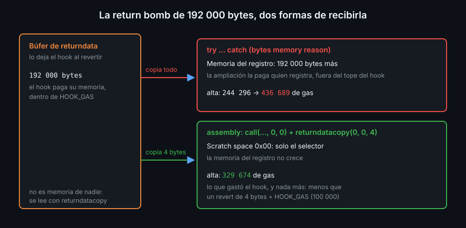

# Teoría 03 — Llamadas, errores y despliegues

## 🎯 Objetivos

- Llamar a otro contrato desde assembly con `call` y `staticcall`, y leer lo que devuelve.
- Saber qué comprueba Solidity en una llamada y qué tienes que comprobar tú en assembly.
- Copiar de la returndata solo lo que necesitas y propagar el error de otro contrato.
- Revertir con un custom error codificado a mano.
- Desplegar con `create2` desde assembly y detectar un despliegue fallido.

## Qué problema resuelve

`token.balanceOf(account)` en Solidity es una línea. Por debajo, solc genera decenas de
instrucciones: codifica la calldata, comprueba que `token` tiene código, llama, mira si salió
bien, propaga el error si no, copia **toda** la returndata a memoria y la decodifica comprobando
su tamaño.

Casi siempre eso es lo que quieres. Dos veces no:

- Cuando la returndata la elige alguien que no es de fiar. Copiarla entera es la **return bomb**
  de la semana 21: el otro devuelve 192 000 bytes y tú pagas la memoria. Es el proyecto de esta
  semana.
- Cuando quieres un comportamiento que Solidity no da: propagar el error de otro contrato tal
  cual, o seguir aunque el otro falle sin pagar por su motivo.

En assembly cada una de esas instrucciones la decides tú. Las que no escribes, no se
hacen.

## Cómo funciona

### `call` y sus siete argumentos

```text
ok := call(gas, destino, valor, entrada, tamañoEntrada, salida, tamañoSalida)
```

| Argumento | Qué es |
| --------- | ------ |
| `gas` | Tope de gas para la llamada. `gas()` es todo lo que queda (menos 1/64, semana 21) |
| `destino` | La dirección |
| `valor` | Wei que se envían. `staticcall` y `delegatecall` no lo llevan |
| `entrada`, `tamañoEntrada` | Dónde está la calldata en **tu** memoria y cuántos bytes |
| `salida`, `tamañoSalida` | Dónde copiar la respuesta y **cuántos bytes como mucho** |

Devuelve `1` si la llamada acabó bien y `0` si revirtió o se quedó sin gas. **No revierte**: si
no miras `ok`, un fallo pasa por un éxito.

`staticcall` es igual sin `valor`, y revierte si el otro intenta escribir storage (semana 10).

### La returndata

Al acabar la llamada, la respuesta entera queda en un **búfer de returndata**, aparte de tu
memoria. Hasta la siguiente llamada:

- `returndatasize()` da su tamaño.
- `returndatacopy(destino, desde, n)` copia `n` bytes a tu memoria. Si `desde + n` pasa de
  `returndatasize()`, **revierte** toda tu llamada. No es como `calldataload`, que completa con
  ceros.

`call` con `tamañoSalida = 32` copia como mucho 32 bytes. Con `0`, no copia nada: después decides
tú qué copiar, mirando `returndatasize()`.



### Lo que Solidity comprueba y `call` no

**Que haya código.** Una llamada a una dirección sin código no ejecuta nada y acaba bien. Del
contrato `Snippets` de la teoría 01:

```solidity
function eoaCall(address target) external returns (bool ok, uint256 size, uint256 codeSize) {
    assembly {
        ok := call(gas(), target, 0, 0, 0, 0, 0)
        size := returndatasize()
        codeSize := extcodesize(target)
    }
}
```

Con una cuenta sin código, `makeAddr("nadie")`:

```text
  call a una cuenta sin codigo: ok
  returndatasize: 0
  extcodesize: 0
```

Si con eso lees el saldo de un "token" que no existe, `mload(0)` te da lo que hubiera en el
scratch space. Por eso el paso 2 del ejercicio 03 exige `returndatasize()` de 32 bytes o más: una
cuenta sin código no devuelve nada.

**Que la respuesta tenga el tamaño esperado.** El decodificador de Solidity revierte si un
`uint256` no llega entero. En assembly, `mload` sobre una copia corta lee lo que había antes en
esa memoria.

### Errores: codificarlos y propagarlos

Un custom error es un selector y sus argumentos en ABI (semana 27), igual que una llamada. Para
`NotOwner(address caller)`, selector `0x245aecd3` (`cast sig "NotOwner(address)"`):

```solidity
mstore(0, shl(224, 0x245aecd3)) // el selector en los 4 bytes altos de la palabra 0
mstore(4, caller())             // el argumento, de 0x04 a 0x23
revert(0, 0x24)                 // 4 + 32 bytes
```

`mstore(4, ...)` escribe de `0x04` a `0x23`: pisa los 28 bytes bajos de la primera palabra (que
eran cero) y los 4 primeros de la segunda. Todo dentro del scratch space.

Para **propagar** el error de otro contrato, tal cual:

```solidity
if iszero(ok) {
    let ptr := mload(0x40)
    returndatacopy(ptr, 0, returndatasize())
    revert(ptr, returndatasize())
}
```

Se copia a memoria libre, no al scratch space: el error puede tener más de 64 bytes. No hace falta
mover el puntero: `revert` acaba la ejecución y nadie más usa esa memoria. Es el paso 3 del
ejercicio 03.

### Despliegues: `create` y `create2`

```text
nueva := create(valor, código, tamaño)
nueva := create2(valor, código, tamaño, sal)
```

Despliegan el *init code* (semana 10) que está en tu memoria y devuelven la dirección nueva.
Como `call`, **no revierten** si algo sale mal: devuelven la dirección 0. Tres causas:

- El constructor revierte.
- Ya hay un contrato en esa dirección. Con `create2`, la misma sal y el mismo código dan la misma
  dirección.
- No hay gas o ETH suficiente.

Un choque de dirección, además, gasta **todo** el gas que le das. Medido con el `deploy` del
ejercicio 03 y un tope de 1 000 000:

```text
  gas de un create2 que choca: 1001090
  gas de un create2 que despliega: 235232
```

`new Contrato{salt: s}()` de Solidity comprueba la dirección y revierte; en assembly, compruébala
tú con `if iszero(nueva) { ... }`.

## Cómo se escribe

Leer un saldo de un ERC-20 con la calldata en el scratch space:

```solidity
function balanceOf(address token, address account) external view returns (uint256 amount) {
    assembly ("memory-safe") {
        mstore(0, shl(224, 0x70a08231)) // balanceOf(address)
        mstore(4, account)
        let ok := staticcall(gas(), token, 0, 0x24, 0, 0x20)
        if iszero(and(ok, gt(returndatasize(), 0x1f))) {
            mstore(0, shl(224, 0x732d20af)) // BadToken(address)
            mstore(4, token)
            revert(0, 0x24)
        }
        amount := mload(0)
    }
}
```

`staticcall(..., 0, 0x20)` copia como mucho 32 bytes a `0x00`. `and(ok, gt(returndatasize(), 0x1f))`
pide las dos cosas a la vez: que la llamada saliera bien y que devolviera al menos 32 bytes.

Llamar copiando como mucho `maxCopy` bytes:

```solidity
ok := call(gas(), target, 0, add(payload, 0x20), mload(payload), 0, 0)
let size := returndatasize()
if gt(size, maxCopy) { size := maxCopy }
head := mload(0x40)
mstore(head, size)
returndatacopy(add(head, 0x20), 0, size)
mstore(0x40, add(add(head, 0x20), and(add(size, 0x1f), not(0x1f))))
```

`head` es un `bytes memory` que Solidity devuelve: por eso, al final, el puntero se mueve detrás
de los datos, redondeado a palabras. Con un destino que revierte con 100 000 bytes, en el paso 4
del ejercicio 03:

```text
  gas copiando 4 bytes: 64235
  gas copiando 100 000 bytes: 286041
```

## ⚠️ Antipatrones y riesgos

- **No mirar `ok`.** `call` no revierte. Un pago que falla, sin comprobar `ok`, se da por hecho.
- **Llamar a una dirección sin código** y tomar el éxito por una respuesta. Comprueba
  `extcodesize` o el tamaño de la returndata.
- **`returndatacopy` más allá de la returndata.** Revierte tu llamada entera. Copia
  `min(returndatasize(), lo que necesitas)`.
- **Copiar toda la returndata de alguien que no es de fiar.** Es la return bomb: pon tope a lo
  que copias, no solo al gas.
- **Leer la respuesta con `mload` sin mirar su tamaño.** Lees lo que hubiera antes en esa memoria.
- **Tomar la dirección 0 de `create2` por un contrato.** Una llamada a ella "funciona": no tiene
  código.
- **Escribir mal un selector.** Nadie lo comprueba al compilar: sale otro error, o una llamada a
  otra función. Sácalo con `cast sig` y que un test compare con `Contrato.Error.selector`.

## 💡 Trucos

- `cast sig "NotOwner(address)"` da el selector de un error o una función.
- Para custom errors sin argumentos, `mstore(0, shl(224, selector))` y `revert(0, 4)`.
- `NotOwner.selector` no se puede escribir dentro del bloque:

  ```solidity
  assembly {
      mstore(0, NotOwner.selector) // ❌ Error (7944): The suffixes ".offset", ".slot" and ".length" can only be used with variables.
  }
  ```

  Guárdalo antes en una variable local (`bytes4 sel = NotOwner.selector;`) o escríbelo como
  número, con un test que compare los dos.

## ✅ Checklist

- [ ] Sé qué es cada uno de los siete argumentos de `call` y qué devuelve.
- [ ] Sé que `call`, `create` y `create2` no revierten al fallar.
- [ ] Sé qué hace `returndatacopy` fuera de rango y cómo copiar solo lo que necesito.
- [ ] Sé codificar un custom error a mano y propagar el de otro contrato.
- [ ] Sé por qué una llamada a una cuenta sin código sale bien.

---

| Anterior | Actual | Siguiente |
| -------- | ------ | --------- |
| [← Teoría 02 — Assembly dentro de Solidity](02-assembly-dentro-de-solidity.md) | **Teoría 03 — Llamadas, errores y despliegues** | [Teoría 04 — Probar y auditar assembly →](04-probar-y-auditar-assembly.md) |
