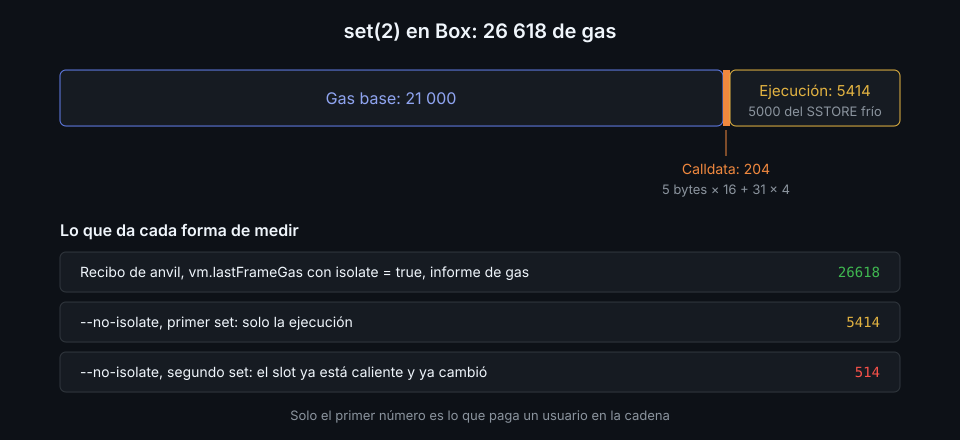

# Teoría 01 — Medir el gas

## 🎯 Objetivos

- Descomponer el gas de una transacción: el gas base, la calldata, la ejecución y el reembolso.
- Explicar qué hace el aislamiento de Foundry (`isolate`) y por qué cambia los números.
- Saber qué número da cada herramienta: la columna de `forge test`, la traza, el informe de gas,
  `vm.lastFrameGas` y el recibo de anvil.
- Fijar un tope de gas en un test y guardar el gas con nombre en un snapshot que se comprueba.

## Qué problema resuelve

Optimizar sin medir es adivinar. Y medir mal es peor que no medir: te hace aceptar un cambio que
no ahorra nada, o rechazar uno que sí ahorra. En la semana 09 usaste el informe de gas y
`forge snapshot`; en la semana 27 viste el precio de cada opcode en una traza. Pero el mismo
`set(2)` de un contrato de una línea puede dar 26 618, 5414 o 79 416 según dónde mires, y los tres
números son "el gas". Esta teoría te dice qué es cada uno y cuál usar para decidir.

## Cómo funciona

### El gas de una transacción

Una transacción paga cuatro cosas (semana 02 y semana 27):

| Parte | Precio | Para qué |
| ----- | ------ | -------- |
| Gas base (*intrinsic gas*) | 21 000 | Cualquier transacción, aunque no haga nada |
| Calldata | 16 por byte distinto de cero, 4 por byte a cero | Los datos que envías: cada nodo los guarda |
| Ejecución | Lo que cuesta cada opcode | El código del contrato |
| Reembolso (*refund*) | Se resta al final, hasta un quinto del total | Poner a cero slots de storage (EIP-3529) |

El contrato de esta teoría es el más pequeño posible. **Dónde**: en un proyecto Foundry nuevo,
en `src/Box.sol`:

```solidity
// SPDX-License-Identifier: MIT
pragma solidity 0.8.38;

contract Box {
    uint256 public value = 1;

    function set(uint256 v) external {
        value = v;
    }
}
```

Desplegado en anvil, `set(2)` da este recibo:

```bash
cast send $BOX "set(uint256)" 2 --private-key $PK --json | jq -r ".gasUsed" | cast to-dec
```

```text
26618
```

La calldata de `set(2)` son 36 bytes: el selector `0x60fe47b1`, 4 bytes distintos de cero, y una
palabra con el 2, un byte distinto de cero y 31 a cero. Son 4 × 16 + 16 + 31 × 4 = 204. Lo demás es
la ejecución: 26 618 − 21 000 − 204 = **5414**, y de esos, 5000 son el `SSTORE` frío de 1 a 2
(2900 + 2100, semana 27).



### El reembolso

`set(0)` pone el slot a cero. El recibo:

```text
21806
```

La ejecución cuesta lo mismo que antes (el `SSTORE` de 1 a 0 también es de 2900 + 2100), pero
borrar un slot devuelve 4800 al final. El recibo ya lleva el reembolso restado: 26 606 − 4800 =
21 806. Como el reembolso no pasa de un quinto del gas usado, borrar no sale gratis: en una
transacción que escribe y borra el mismo slot, el tope corta casi todo lo que borrar devolvería
(teoría 02).

### El aislamiento de Foundry

Un test de Foundry es una función que se ejecuta entera dentro de una sola llamada. Si las
llamadas que hace se ejecutaran ahí dentro, la segunda encontraría caliente (semana 27) todo lo que
tocó la primera, y ninguna pagaría el gas base. Foundry 1.9 las aísla por defecto:

```bash
forge config | grep isolate
```

```text
isolate = true
```

Con `isolate = true`, cada llamada que el test hace a otro contrato se ejecuta como su propia
transacción: con su gas base, su calldata y todos los slots fríos. Es lo que pasa en la cadena,
donde cada usuario envía su transacción.

**Dónde**: en `test/Box.t.sol`:

```solidity
// SPDX-License-Identifier: MIT
pragma solidity 0.8.38;

import {Test, Vm, console} from "forge-std/Test.sol";
import {Box} from "../src/Box.sol";

contract BoxTest is Test {
    Box box;

    function setUp() public {
        box = new Box();
    }

    function test_SetTwice() public {
        box.set(2);
        console.log("set(2):", vm.lastFrameGas().gasTotalUsed);
        box.set(3);
        console.log("set(3):", vm.lastFrameGas().gasTotalUsed);
    }

    function test_SetToZero() public {
        box.set(0);
        Vm.Gas memory gas = vm.lastFrameGas();
        console.log("usado:", gas.gasTotalUsed);
        console.log("reembolso:", uint256(int256(gas.gasRefunded)));
    }

    function test_SetFitsBudget() public {
        box.set(2);
        assertLt(vm.lastFrameGas().gasTotalUsed, 27_000);
        vm.snapshotGasLastFrame("set");
    }
}
```

`vm.lastFrameGas()` devuelve el gas de la última llamada que hizo el test en un struct `Vm.Gas`.
`gasTotalUsed` es el gas usado **antes** del reembolso, y `gasRefunded`, el reembolso.

```bash
forge test -vv
```

```text
[PASS] test_SetFitsBudget() (gas: 37186)
[PASS] test_SetToZero() (gas: 38484)
  usado: 26606
  reembolso: 4800
[PASS] test_SetTwice() (gas: 79416)
  set(2): 26618
  set(3): 26618
```

Los dos `set` cuestan lo mismo que el recibo de anvil: cada uno es una transacción nueva. Ahora
sin aislar:

```bash
forge test -vv --no-isolate
```

```text
[PASS] test_SetFitsBudget() (gas: 15982)
[PASS] test_SetToZero() (gas: 14792)
  usado: 5414
  reembolso: 4800
[PASS] test_SetTwice() (gas: 22608)
  set(2): 5414
  set(3): 514
```

Sin el gas base y sin la calldata, `set(2)` da la ejecución sola: 5414. Y `set(3)` da 514, porque
el slot ya estaba caliente y ya había cambiado en la misma "transacción": su `SSTORE` cuesta 100.
En la cadena, nadie paga 514 por un `set`.

Las llamadas `view` o `pure` que hace un test no se aíslan: son `STATICCALL` dentro del test y no
pagan gas base. Su `gasTotalUsed` es solo su ejecución.

### Qué número da cada herramienta

| Herramienta | `set(2)` | Qué es |
| ----------- | -------- | ------ |
| Columna `(gas: ...)` de `forge test` | 79 416 | El test entero, con los `console.log` y todas sus llamadas. No sirve para comparar una función |
| Traza de `forge test -vvvv` | `[26618] Box::set(2)` | El gas de cada llamada, con sus subllamadas anidadas |
| `forge test --gas-report` | 26 618 en `set` | Mínimo, media, mediana y máximo de cada función entre todas las llamadas de los tests |
| `vm.lastFrameGas().gasTotalUsed` | 26 618 | La última llamada, antes del reembolso. Con aislamiento, con gas base y calldata |
| Recibo de anvil (`gasUsed`) | 26 618 | Lo que se paga de verdad, ya con el reembolso restado |

Detrás de un proxy (semana 15), el informe de gas pone en la implementación el gas de su
`delegatecall`, no el de la transacción. En el registro de la semana 28, un alta da 316 108 en el
informe y 342 557 en `vm.lastFrameGas`: la diferencia es el gas base, la calldata y lo que gasta el
proxy antes de delegar.

## Cómo se escribe

### Un tope de gas en un test

`test_SetFitsBudget` falla si `set(2)` pasa de 27 000. Un tope así convierte el gas en un requisito:
si alguien añade una escritura a `set`, el test se pone en rojo y no se fusiona sin que alguien lo
decida. Los tests de gas de los ejercicios de esta semana son de este tipo.

El tope vale para un compilador, una configuración del optimizador y unas entradas concretas. Con
otro valor de `v`, otra versión de solc u otras ejecuciones del optimizador (teoría 03), el número
cambia.

### Snapshots con nombre

`vm.snapshotGasLastFrame("set")` guarda el gas de la última llamada en
`snapshots/<Contrato del test>.json`, sin el ruido del resto del test:

```bash
cat snapshots/BoxTest.json
```

```text
{
  "set": "26618"
}
```

Cada `forge test` reescribe ese archivo. Con `FORGE_SNAPSHOT_CHECK=true`, en cambio, Foundry
compara cada número con el que ya hay y falla si alguno cambió. Así queda si el archivo se
guardó con `--no-isolate` y los tests se ejecutan con aislamiento:

```bash
FORGE_SNAPSHOT_CHECK=true forge test --mt test_SetFitsBudget
```

```text
[BoxTest] Failed to match snapshots:
- [set] 5414 → 26618

Error: Snapshots differ from previous run
```

Con el archivo en git, `FORGE_SNAPSHOT_CHECK=true` en tu `test.sh` garantiza que los números que
citas son los del código actual. Es lo que hace el proyecto de esta semana.

### El recibo como árbitro

Si un número de los tests te sorprende, despliega en anvil y mira el recibo: es lo que pagaría
un usuario. Los pasos son los de la semana 03:

```bash
anvil --silent &
BOX=$(forge create src/Box.sol:Box --private-key $PK --broadcast | grep "Deployed to" | awk '{print $3}')
cast send $BOX "set(uint256)" 2 --private-key $PK --json | jq -r ".gasUsed" | cast to-dec
```

`$PK` es la clave de la primera cuenta de prueba de anvil, la de la semana 03. `cast estimate`
da el gas antes de enviar: `cast estimate $BOX "set(uint256)" 5`, con el slot a 0 después del
`set(0)`, da 43 718, porque escribir en un slot a cero cuesta 20 000 (más 2100 por ser frío).

## ⚠️ Antipatrones y riesgos

- **Medir con `--no-isolate`, o con `gasleft()` alrededor de dos llamadas en el mismo test.** La
  segunda encuentra caliente lo que tocó la primera: `set(3)` da 514 en vez de 26 618. Un ahorro
  medido así puede no existir en la cadena.
- **Comparar la columna `(gas: ...)` de dos tests.** Incluye todo lo que hace el test. Compara
  llamadas, con `vm.lastFrameGas` o con un snapshot con nombre.
- **Medir con una sola entrada.** El primer alta de una cuenta escribe slots a cero y la segunda
  no: en el registro de la semana 28, 342 557 frente a 239 957. Mide el caso que se repite, y di
  cuál mediste.
- **Contar el reembolso como un ahorro entero.** El recibo lo resta, pero con el tope de un quinto.
  Si tu optimización depende del reembolso, mira el recibo, no `gasTotalUsed`.
- **Comparar números de configuraciones distintas.** Con el optimizador activado o con otra
  versión de solc, todo cambia (teoría 03). Un snapshot solo se compara con otro de la misma
  configuración.
- **Optimizar lo que nadie llama.** Una función de administración que se llama una vez al año no
  merece código más difícil de leer. Optimiza lo que pagan los usuarios en cada transacción.

## 💡 Trucos

- `forge snapshot --diff` (semana 09) compara la columna de gas de todos los tests con el
  `.gas-snapshot` guardado: es la forma rápida de ver qué tests cambiaron tras una refactorización.
- En la traza de `-vvvv`, el número entre corchetes de cada llamada incluye el de sus subllamadas:
  resta los hijos para saber cuánto gasta el contrato que te interesa.
- Para ver el reembolso sin desplegar, `vm.lastFrameGas().gasRefunded`.

## ✅ Checklist

- [ ] Sé descomponer el gas de una transacción en gas base, calldata, ejecución y reembolso.
- [ ] Sé qué hace `isolate = true` y por qué `--no-isolate` da números que nadie paga.
- [ ] Sé qué número dan la columna de `forge test`, la traza, el informe de gas,
  `vm.lastFrameGas` y el recibo.
- [ ] Sé fijar un tope de gas en un test y guardar un snapshot con nombre.
- [ ] Sé qué hace `FORGE_SNAPSHOT_CHECK=true` y cuándo usarlo.

---

| Anterior | Actual | Siguiente |
| -------- | ------ | --------- |
| [← Semana 29 — Optimización de gas](../README.md) | **Teoría 01 — Medir el gas** | [Teoría 02 — El storage manda →](02-el-storage-manda.md) |
