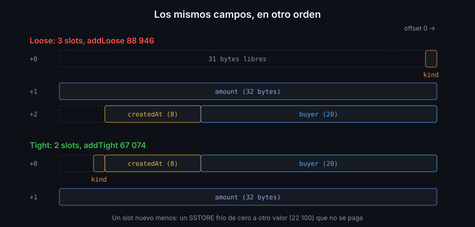

# Teoría 02 — El storage manda

## 🎯 Objetivos

- Explicar por qué el storage es casi siempre lo más caro de una transacción.
- Empaquetar un `struct` ordenando sus campos, y saber cuándo un tipo pequeño no ahorra nada.
- Leer y escribir cada slot una vez, con variables locales.
- Guardar muchos `bool` en un bitmap, valores fijos en `constant` e `immutable`, y datos que solo
  se leen fuera de la cadena en eventos.
- Elegir un cerrojo contra reentrancy sabiendo lo que hace el tope del reembolso.

## Qué problema resuelve

En la traza de la semana 27, una suma o una comparación cuestan 3 de gas, y un `SSTORE` de cero a
otro valor, 20 000. Seis mil veces más. Por eso, en casi cualquier función que escribe, el gas lo
deciden los slots que toca, no las líneas de código que tiene. La regla de esta teoría es una sola:
**toca menos slots, y toca cada uno menos veces**. Las técnicas son formas distintas de cumplirla.

Recuerda los precios (semana 27):

| Acceso | Gas |
| ------ | --- |
| `SLOAD` frío / caliente | 2100 / 100 |
| `SSTORE` de cero a otro valor | 20 000, + 2100 si es frío |
| `SSTORE` de un valor a otro | 2900, + 2100 si es frío |
| `SSTORE` en un slot que ya cambió en esta transacción | 100 |
| Poner a cero | Lo mismo que de un valor a otro, con reembolso de 4800 al final |

## Cómo funciona

### Empaquetar un `struct`

Solc mete en el mismo slot las variables y los campos consecutivos que caben en 32 bytes, en el
orden en que los declaras (semana 27). Si un campo no cabe en lo que queda del slot, empieza uno
nuevo. El orden de los campos decide cuántos slots ocupa un `struct`.

**Dónde**: en `src/Orders.sol` de un proyecto Foundry:

```solidity
// SPDX-License-Identifier: MIT
pragma solidity 0.8.38;

contract Orders {
    struct Loose {
        uint8 kind;
        uint256 amount;
        address buyer;
        uint64 createdAt;
    }

    struct Tight {
        address buyer;
        uint64 createdAt;
        uint8 kind;
        uint256 amount;
    }

    mapping(uint256 => Loose) public loose;
    mapping(uint256 => Tight) public tight;

    function addLoose(uint256 id, uint256 amount) external {
        loose[id] = Loose({kind: 1, amount: amount, buyer: msg.sender, createdAt: uint64(block.timestamp)});
    }

    function addTight(uint256 id, uint256 amount) external {
        tight[id] = Tight({kind: 1, amount: amount, buyer: msg.sender, createdAt: uint64(block.timestamp)});
    }
}
```

Los dos structs tienen los mismos campos. En `Loose`, `kind` ocupa 1 byte del primer slot,
`amount` no cabe en los 31 que quedan y empieza otro, y `buyer` y `createdAt` van juntos en un
tercero. En `Tight`, `buyer`, `createdAt` y `kind` suman 29 bytes y comparten el primer slot.



**Dónde**: en `test/Orders.t.sol`:

```solidity
// SPDX-License-Identifier: MIT
pragma solidity 0.8.38;

import {Test, console} from "forge-std/Test.sol";
import {Orders} from "../src/Orders.sol";

contract OrdersTest is Test {
    function test_Orders() public {
        Orders orders = new Orders();
        orders.addLoose(1, 100);
        console.log("Loose:", vm.lastFrameGas().gasTotalUsed);
        orders.addTight(1, 100);
        console.log("Tight:", vm.lastFrameGas().gasTotalUsed);
    }
}
```

```bash
forge test -vv
```

```text
  Loose: 88946
  Tight: 67074
```

21 872 de diferencia: un `SSTORE` frío de cero a otro valor menos, con el mismo código.

Empaquetar solo ahorra si los campos que comparten slot se escriben y se leen **juntos**. Un
`uint8` solo en su slot ocupa el slot entero, y solc añade instrucciones para aislar su byte al
leerlo y al escribirlo: el `set(2)` de la teoría 01 con `uint8 public x` en vez de
`uint256 public value` cuesta 26 676 en vez de 26 618. Y si dos campos del mismo slot se escriben en
transacciones distintas, cada escritura paga el slot entero igual.

### Leer una vez, escribir una vez

Cada lectura de una variable de estado es un `SLOAD`, y cada asignación, un `SSTORE`. Solc sin
optimizador no los junta: `total += x` dentro de un bucle de 10 vueltas son 10 `SLOAD` y 10
`SSTORE`. La primera vuelta paga el acceso frío y las demás 100 cada una, pero suman. La forma
barata es leer a una variable local antes del bucle, trabajar con ella y escribir el resultado
una vez, al final. Lo mismo con la longitud de un array de storage en la condición del bucle: cada
vuelta la vuelve a leer. Lo haces en el paso 2 del ejercicio 01.

### Muchos `bool` en un bitmap

Un `mapping(uint256 => bool)` gasta un slot entero por cada `bool`: marcar el premio 0, el 1 y el
2 son tres escrituras de cero a otro valor, 22 100 cada una. Un **bitmap** guarda 256 `bool` en
una palabra, un bit cada uno:

```solidity
mapping(uint256 => uint256) private _words;

function _set(uint256 i) internal {
    _words[i >> 8] |= 1 << (i & 0xff);
}

function _get(uint256 i) internal view returns (bool) {
    return _words[i >> 8] & (1 << (i & 0xff)) != 0;
}
```

`i >> 8` es la palabra (`i / 256`) y `i & 0xff`, el bit dentro de ella (`i % 256`). Marcar el
primer premio de una palabra sigue costando un `SSTORE` de cero a otro valor; los 255 siguientes
de esa palabra, uno de un valor a otro, 2900 + 2100 en frío. Solo ahorra si los índices son
consecutivos o cercanos: 256 premios con índices al azar caen en 256 palabras distintas.

### `constant` e `immutable`

Una variable que no cambia nunca no tiene por qué vivir en storage (semana 04). `constant` se
sustituye en el código al compilar; `immutable` se fija en el constructor y queda escrita en el
bytecode desplegado. Leer cualquiera de las dos es un `PUSH`, no un `SLOAD`:

```solidity
contract Reads {
    uint256 public constant FEE_CONSTANT = 7;
    uint256 public immutable FEE_IMMUTABLE;
    uint256 public feeStorage = 7;

    constructor() {
        FEE_IMMUTABLE = 7;
    }

    function readConstant() external pure returns (uint256) {
        return FEE_CONSTANT;
    }

    function readImmutable() external view returns (uint256) {
        return FEE_IMMUTABLE;
    }

    function readStorage() external view returns (uint256) {
        return feeStorage;
    }
}
```

Llamadas desde un test, con `vm.lastFrameGas().gasTotalUsed` después de cada una (son `view`: no
se aíslan, teoría 01):

| Lee de | Gas de la llamada |
| ------ | ----------------- |
| `constant` | 420 |
| `immutable` | 354 |
| Variable de estado | 2431 |

La diferencia entre las dos primeras no es la lectura: es el orden en que el contrato busca el
selector de cada función. La tercera paga los 2100 de un `SLOAD` frío.

### Eventos en vez de storage

Un contrato no puede leer los eventos: solo los leen los clientes fuera de la cadena (semanas 07 y
19). Si un dato solo se guarda para que lo lea el indexador o la página, un evento cuesta mucho
menos: 375 por el log, 375 por cada topic y 8 por byte de datos, frente a 22 100 por cada palabra
nueva en storage. El precio es que ningún contrato, tampoco el tuyo en una versión futura, podrá
consultar ese dato.

### Cerrojos y el tope del reembolso

Un cerrojo contra reentrancy (semana 21) se pone al entrar y se quita al salir. Tres formas,
cada una en un contrato con un contador que ya vale 1:

```solidity
contract ZeroOneLock {
    uint256 private _locked;
    uint256 public counter = 1;

    function bump() external {
        require(_locked == 0, "locked");
        _locked = 1;
        counter++;
        _locked = 0;
    }
}

contract OneTwoLock {
    uint256 private _locked = 1;
    uint256 public counter = 1;

    function bump() external {
        require(_locked == 1, "locked");
        _locked = 2;
        counter++;
        _locked = 1;
    }
}

contract TransientLock {
    bool transient _locked;
    uint256 public counter = 1;

    function bump() external {
        require(!_locked, "locked");
        _locked = true;
        counter++;
        _locked = false;
    }
}
```

`bool transient` es una variable de estado en transient storage (semana 27): solc la lee y la
escribe con `TLOAD` y `TSTORE`, 100 cada uno. Una llamada a `bump` de cada uno, con
`vm.lastFrameGas()`:

| Cerrojo | Usado | Reembolso | Pagado |
| ------- | ----- | --------- | ------ |
| 0 → 1 → 0 | 48 607 | 9721 | 38 886 |
| 1 → 2 → 1 | 31 509 | 2800 | 28 709 |
| `transient` | 27 043 | 0 | 27 043 |

El de 0 y 1 escribe un slot a cero, 22 100, y lo devuelve a cero: le corresponderían 19 900 de
reembolso, pero el tope es un quinto del gas usado, 48 607 / 5 = 9721. El de 1 y 2 nunca pasa por
cero: paga 5000 por el primer cambio y recupera 2800 al devolver el valor original. Por eso
`ReentrancyGuard` de OpenZeppelin usa 1 y 2, y desde la versión 5.1 ofrece también
`ReentrancyGuardTransient`.

## ⚠️ Antipatrones y riesgos

- **Encoger un tipo para empaquetar sin comprobar el rango.** Un `uint96` guarda hasta unos
  7,9 × 10²⁸; `uint96(x)` con un `x` mayor corta los bits altos sin revertir. Comprueba el rango
  antes de convertir: es el paso 1 del ejercicio 03.
- **Reordenar los campos de un `struct` en un contrato actualizable.** El proxy ya tiene datos
  con el orden viejo: la versión nueva los leería del slot de otro campo (semana 15). Empaquetar es
  una decisión del primer despliegue.
- **Cachear un valor de storage y escribirlo después de una llamada externa.** Si quien recibe la
  llamada vuelve a entrar, ve el valor viejo: es la reentrancy de la semana 21 con otro nombre. El
  paso 3 del ejercicio 03 lo provoca.
- **Un bitmap con la máscara mal calculada.** `i & 0x7f` en vez de `i & 0xff` hace que el premio
  128 y el 0 compartan bit. Pruébalo con dos índices de la misma palabra y de palabras vecinas.
- **Pasar a eventos un dato que un contrato necesita leer.** Lo que no está en storage no existe
  para la EVM.

## 💡 Trucos

- `forge inspect <Contrato> storageLayout` da el slot y el offset de cada variable de estado: mira
  ahí si un cambio empaquetó lo que querías.
- Un `struct` que se escribe entero al crearlo y casi no cambia después es el mejor candidato a
  empaquetar; uno con un campo que cambia en cada transacción, no tanto.
- Cuenta los slots que toca una función antes de medirla: `vm.record()` y
  `vm.accesses(address)` devuelven las lecturas y escrituras de storage de un contrato.

## ✅ Checklist

- [ ] Sé por qué un `SSTORE` de cero a otro valor decide el gas de casi cualquier escritura.
- [ ] Sé ordenar los campos de un `struct` para que ocupe menos slots, y cuándo no ahorra.
- [ ] Sé leer y escribir cada slot una vez con variables locales.
- [ ] Sé escribir un bitmap y sé cuándo ahorra.
- [ ] Sé cuándo usar `constant`, `immutable` o un evento en vez de storage.
- [ ] Sé por qué un cerrojo de 1 y 2 gasta menos que uno de 0 y 1, y qué cuesta uno `transient`.

---

| Anterior | Actual | Siguiente |
| -------- | ------ | --------- |
| [← Teoría 01 — Medir el gas](01-medir-el-gas.md) | **Teoría 02 — El storage manda** | [Teoría 03 — El código y el compilador →](03-el-codigo-y-el-compilador.md) |
