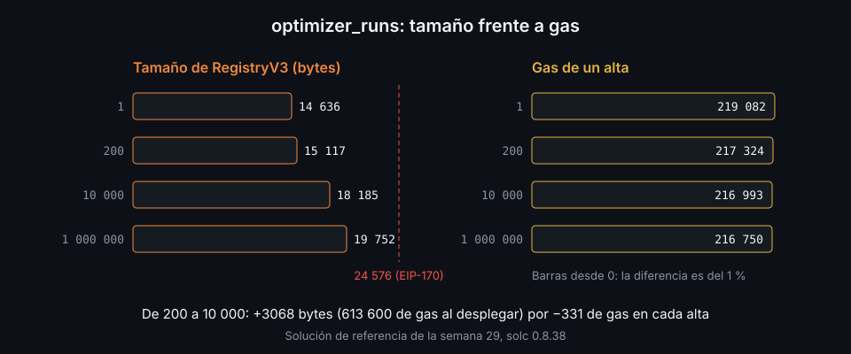

# Teoría 03 — El código y el compilador

## 🎯 Objetivos

- Elegir `calldata` o `memory` para los parámetros, y un puntero `storage` o una copia en
  `memory` para leer un `struct`.
- Medir lo que ahorran los custom errors en tamaño y en gas frente a los mensajes de texto.
- Ordenar las condiciones para que la barata vaya primero.
- Usar `unchecked` solo donde una comprobación anterior lo garantiza, y saber qué hace ya solc con
  el contador de un bucle.
- Explicar qué hace el optimizador de solc, qué significan sus ejecuciones (`runs`) y qué cambia
  `via_ir`.

## Qué problema resuelve

Fuera del storage, el gas lo gastan las copias de datos, las comprobaciones repetidas y el
bytecode que el compilador genera. Cada cosa cuesta poco: decenas o cientos de gas, no miles. Pero
en una función que recorre un array, ese poco se multiplica por cada vuelta. Y el tamaño del
bytecode tiene su propio límite: 24 576 bytes por contrato (EIP-170), el que obligó a activar el
optimizador en la semana 20.

## Cómo funciona

### `calldata` o `memory`

Un parámetro `memory` de una función `external` se copia de la calldata a memoria al entrar: cada
palabra, una lectura y una escritura, más lo que cuesta ampliar la memoria (semana 27). Uno
`calldata` no se copia: cada lectura es un `CALLDATALOAD`. Si la función no modifica el array, no
hay razón para copiarlo.

**Dónde**: en `src/Sums.sol`:

```solidity
// SPDX-License-Identifier: MIT
pragma solidity 0.8.38;

contract Sums {
    function sumMemory(uint256[] memory xs) external pure returns (uint256 total) {
        for (uint256 i = 0; i < xs.length; i++) {
            total += xs[i];
        }
    }

    function sumCalldata(uint256[] calldata xs) external pure returns (uint256 total) {
        for (uint256 i = 0; i < xs.length; i++) {
            total += xs[i];
        }
    }

    function sumPreIncrement(uint256[] calldata xs) external pure returns (uint256 total) {
        for (uint256 i = 0; i < xs.length; ++i) {
            total += xs[i];
        }
    }

    function sumUncheckedIncrement(uint256[] calldata xs) external pure returns (uint256 total) {
        for (uint256 i = 0; i < xs.length;) {
            total += xs[i];
            unchecked {
                ++i;
            }
        }
    }
}
```

Llamadas desde un test con arrays de 10 y de 100 elementos, con `vm.lastFrameGas().gasTotalUsed`
después de cada una (son `pure`: sin gas base, teoría 01), sin optimizador:

| Función | 10 elementos | 100 elementos |
| ------- | ------------ | ------------- |
| `sumMemory` | 6333 | 53 784 |
| `sumCalldata` | 3770 | 31 220 |

La copia crece con el array: 2563 de diferencia con 10 elementos, 22 564 con 100. Cuando la
función sí modifica el array, o lo pasa a otra función que espera `memory`, la copia hace falta.

### Un puntero a storage o una copia en memoria

Lo mismo pasa con un `struct` de storage. `Employee memory e = employees[a]` lee **todos** los
slots del struct y los copia a memoria, también los campos que no vas a usar; con un `string`, uno
o más slots más. `Employee storage e = employees[a]` es solo el número del slot: cada `e.campo`
que lees es un `SLOAD` de ese campo y nada más. Si lees uno o dos campos, el puntero; si lees
todos varias veces, la copia puede salir a cuenta. Lo mides en el paso 3 del ejercicio 02.

### Custom errors y mensajes de texto

Un `require(cond, "mensaje")` guarda el texto en el bytecode y, al revertir, lo codifica como
`Error(string)` (semana 05). Un custom error guarda 4 bytes de selector, más sus argumentos.

```solidity
contract WithStrings {
    address public immutable OWNER = msg.sender;

    function guarded(uint256 x) external view returns (uint256) {
        require(msg.sender == OWNER, "WithStrings: only the owner can call this function");
        require(x > 0, "WithStrings: x has to be greater than zero");
        return x;
    }
}

contract WithErrors {
    address public immutable OWNER = msg.sender;

    error NotOwner(address caller);
    error Zero();

    function guarded(uint256 x) external view returns (uint256) {
        if (msg.sender != OWNER) revert NotOwner(msg.sender);
        if (x == 0) revert Zero();
        return x;
    }
}
```

Con `address(c).code.length` y `type(C).creationCode.length` en un test, y el gas de una llamada
de otra cuenta, que revierte en la primera comprobación:

| | Sin optimizador | | Con optimizador (200) | |
| - | ------------- | - | ------------------- | - |
| | Mensajes | Errores | Mensajes | Errores |
| Bytecode desplegado | 967 bytes | 660 bytes | 489 bytes | 350 bytes |
| Bytecode de despliegue | 1062 bytes | 755 bytes | 537 bytes | 398 bytes |
| Llamada que revierte | 737 | 669 | 381 | 319 |

Cada byte del bytecode desplegado cuesta 200 de gas al desplegar. El ahorro grande de los custom
errors está en el tamaño, no en el revert: un contrato cerca de los 24 576 bytes gana espacio.

### Primero lo barato

`a || b` no evalúa `b` si `a` es verdadero, y `a && b` no evalúa `b` si `a` es falso (semana 05).
Si una condición lee storage y la otra compara un parámetro, pon primero la del parámetro: cuando
decide ella, el `SLOAD` no se ejecuta. En un bucle, eso son 2100 por cada vuelta que se ahorra el
acceso frío. Lo mides en el paso 4 del ejercicio 02.

### `unchecked` y el contador del bucle

Desde la 0.8, cada `+`, `-` y `*` comprueba el desbordamiento (semana 05). `unchecked { ... }`
quita esa comprobación: ahorra unas decenas de gas por operación y, si el valor puede salirse de
rango, da la vuelta sin avisar (semana 21). Úsalo solo donde una línea anterior ya garantiza el
rango: `if (amount > balance) revert ...;` y después `unchecked { balance -= amount; }`.

El contador de un `for` es el caso típico, y desde la 0.8.22 solc lo resuelve solo: si la
condición es `i < algo` y el incremento es `i++` o `++i`, el incremento no se comprueba. Con
`Sums` y 100 elementos:

| Función | Sin optimizador | Con optimizador (200) |
| ------- | --------------- | --------------------- |
| `sumCalldata` (`i++`) | 31 220 | 18 197 |
| `sumPreIncrement` (`++i`) | 30 742 | 18 219 |
| `sumUncheckedIncrement` (`unchecked { ++i; }`) | 30 698 | 18 175 |

Con el optimizador, `++i` no es más barato que `i++`, y el `unchecked` a mano ahorra 22 en 100
vueltas. El truco que llena los bucles de código antiguo ya no vale lo que cuesta leerlo.

### El optimizador y sus ejecuciones

El optimizador de solc (`optimizer = true` en `foundry.toml`, semana 20) reescribe el bytecode
sin cambiar lo que hace: calcula al compilar lo que ya se sabe, quita operaciones que se repiten y
código que no se alcanza, y junta lecturas y escrituras. Su parámetro `optimizer_runs` no es
cuántas pasadas hace: es **cuántas veces esperas que se ejecute cada instrucción** del contrato en
toda su vida. Con pocas ejecuciones, el optimizador prefiere bytecode pequeño, barato de
desplegar; con muchas, bytecode más grande que gasta menos al ejecutarse.

El registro de la solución de referencia, compilado con distintos valores
(`FOUNDRY_OPTIMIZER_RUNS=N forge build --sizes` y el gas de un alta):

| `optimizer_runs` | Tamaño de `RegistryV3` | Gas de un alta |
| ---------------- | ---------------------- | -------------- |
| 1 | 14 636 bytes | 219 082 |
| 200 | 15 117 bytes | 217 324 |
| 10 000 | 18 185 bytes | 216 993 |
| 1 000 000 | 19 752 bytes | 216 750 |



Pasar de 200 a 10 000 ejecuciones ahorra 331 de gas por alta y añade 3068 bytes: a 200 de gas por
byte, 613 600 de gas más en cada despliegue. Se recupera tras unas 1850 altas. Para un contrato
que se usa mucho y se despliega pocas veces, pueden valer la pena; para uno que se despliega a
menudo o roza los 24 576 bytes, no.

### `via_ir`

`via_ir = true` cambia la forma de compilar: solc pasa primero el contrato a Yul (semana 28) y
optimiza ese Yul entero, entre funciones. Suele dar mejor código y resuelve muchos
`Stack too deep`, pero compila más despacio y genera bytecode distinto. Con `Sums`, 100 elementos y
el optimizador, `sumMemory` pasa de 26 806 a 21 268 y `sumCalldata`, de 18 197 a 20 342: la copia
a memoria casi desaparece, pero la versión `calldata` sale más cara. Ninguna configuración es
mejor en todo: mide la tuya.

## ⚠️ Antipatrones y riesgos

- **`unchecked` donde ninguna línea anterior garantiza el rango.** Un saldo que baja de cero da
  un número enorme y la cuenta tiene de repente casi 2²⁵⁶. Es el paso 2 del ejercicio 03.
- **Un contador más pequeño que el array.** `for (uint8 i = 0; i < xs.length;)` con
  `unchecked { ++i; }` da la vuelta en 255 y el bucle no acaba nunca: la llamada gasta todo su gas.
  Es el paso 5 del ejercicio 03.
- **Cambiar `optimizer_runs` o `via_ir` sin repetir todos los tests.** Es otro bytecode: un bug del
  compilador en una configuración concreta, o un assembly que no es `memory-safe` (semana 28),
  solo aparece con ella.
- **Copiar a ciegas trucos de gas de artículos antiguos.** `++i`, `!= 0` en vez de `> 0` o
  `external` en vez de `public` se midieron con compiladores de hace años. Mide con el tuyo.

## 💡 Trucos

- `forge build --sizes` da el tamaño de cada contrato y su margen hasta los 24 576 bytes.
- `FOUNDRY_OPTIMIZER_RUNS=N forge test` cambia las ejecuciones sin tocar `foundry.toml`: útil para
  comparar antes de decidir.
- `forge inspect <Contrato> bytecode` y `deployedBytecode` dan el bytecode; su longitud en hex,
  dividida entre 2, son los bytes.

## ✅ Checklist

- [ ] Sé cuándo un parámetro va en `calldata` y cuándo un `struct` se lee con un puntero
  `storage`.
- [ ] Sé qué ahorran los custom errors en tamaño y en gas.
- [ ] Sé ordenar una condición para que lo barato decida primero.
- [ ] Sé dónde es seguro `unchecked` y qué hace ya solc con el contador de un bucle.
- [ ] Sé qué significa `optimizer_runs` y cómo decidirlo con el tamaño y el gas.
- [ ] Sé qué cambia `via_ir` y por qué hay que medirlo.

---

| Anterior | Actual | Siguiente |
| -------- | ------ | --------- |
| [← Teoría 02 — El storage manda](02-el-storage-manda.md) | **Teoría 03 — El código y el compilador** | [Teoría 04 — Cuándo no optimizar →](04-cuando-no-optimizar.md) |
