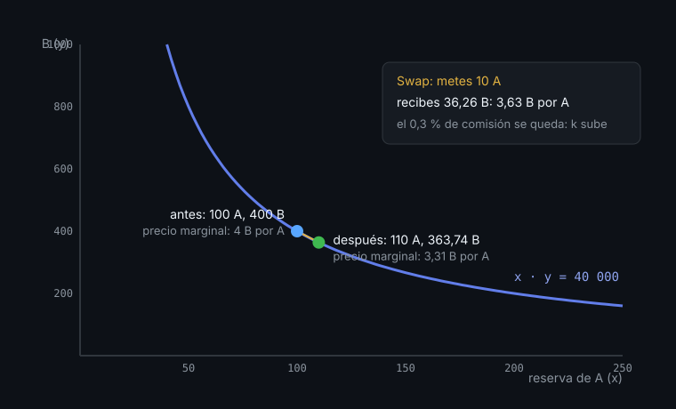

# Teoría 01 — El AMM de producto constante

## 🎯 Objetivos

- Explicar qué es **DeFi** y qué problema resuelve un **AMM** frente a un libro de órdenes.
- Calcular lo que da un swap con la fórmula de producto constante y su comisión.
- Distinguir el precio marginal del precio efectivo de un swap, y medir el impacto en el precio.
- Explicar por qué la comisión hace crecer el producto de las reservas.
- Reconocer los riesgos de un AMM: su precio como oráculo, los tokens raros y el redondeo.

## Qué problema resuelve

**DeFi** (*decentralized finance*, finanzas descentralizadas) son los contratos que hacen lo que
hace un banco o una bolsa: cambiar un token por otro, prestar, pedir prestado, ahorrar con
rendimiento. Sin una empresa en medio: las reglas son el código del contrato, y cualquiera puede
usarlas o leerlas. Esta semana escribes las tres piezas en las que se apoya casi todo lo demás: un
**AMM**, un **vault** y un **préstamo con garantía**.

Una bolsa cambia tokens con un **libro de órdenes**: quien vende dice a qué precio, quien compra
dice a qué precio, y un sistema cruza las órdenes. En la cadena eso es caro: cada orden, cada
cambio y cada cancelación es una transacción, y alguien tiene que estar siempre ofreciendo precio.

Un **AMM** (*automated market maker*, creador de mercado automático) cambia el libro por una
fórmula. El contrato guarda dos **reservas**, una de cada token, y el precio sale de cuánto hay de
cada uno. Quien quiere cambiar no espera a nadie: envía un token al contrato y la fórmula dice
cuánto del otro le devuelve. Es el modelo de Uniswap V2, y el pool de la semana 22 era uno, sin
comisión ni liquidez de varios proveedores.

## Cómo funciona

### La regla: `x · y = k`

Llama `x` a la reserva del token A e `y` a la del B. Un AMM de **producto constante** solo acepta
un swap si, después, el producto de las reservas no ha bajado:

```text
(x + Δx) · (y − Δy) ≥ x · y
```

Quien mete `Δx` de A se lleva `Δy` de B. Sin comisión, el máximo que se puede llevar es el que
deja el producto igual:

```text
Δy = y · Δx / (x + Δx)
```



El **precio marginal** de A es `y / x`: lo que vale una cantidad muy pequeña. Con 100 A y 400 B,
1 A vale 4 B. Pero el swap mueve el punto por la curva, y el **precio efectivo**, lo que de
verdad recibes por cada A, es peor cuanto más grande es el swap: cada A que metes vale menos B que
la anterior. La diferencia es el **impacto en el precio** (*price impact*).

### La comisión

Cada swap paga una **comisión** (*fee*) que se queda en el pool: un 0,3 % en Uniswap V2. Se
descuenta de lo que entra, antes de aplicar la fórmula:

```text
Δx' = Δx · (1 − 0,003)
Δy  = y · Δx' / (x + Δx')
```

El pool recibe el `Δx` entero pero solo paga por el 99,7 %. Ese 0,3 % de más se queda en la
reserva, así que el producto `x · y` **crece** con cada swap. Es lo que ganan quienes ponen la
liquidez (teoría 02).

### Las reservas no son el saldo

El contrato anota sus reservas en dos variables y las cambia en cada operación. Si alguien envía
tokens con un `transfer` directo, el saldo del contrato sube y las reservas no: el precio no se
mueve. Uniswap V2 tiene una función `sync` para igualarlas, y una `skim` para devolver lo que
sobra. Calcular el precio con `balanceOf` en vez de con las reservas deja que cualquiera lo mueva
con un regalo.

## Cómo se escribe

**Dónde**: en `src/Quote.sol` de un proyecto Foundry, con `foundry.toml` de la plantilla del
bootcamp:

```solidity
// SPDX-License-Identifier: MIT
pragma solidity 0.8.38;

library Quote {
    uint256 internal constant FEE_BPS = 30;

    // Lo que sale del pool por `amountIn`: la comisión se descuenta de la entrada.
    function getAmountOut(uint256 amountIn, uint256 reserveIn, uint256 reserveOut) internal pure returns (uint256) {
        uint256 amountInWithFee = amountIn * (10_000 - FEE_BPS);
        return amountInWithFee * reserveOut / (reserveIn * 10_000 + amountInWithFee);
    }
}
```

La comisión va en **puntos básicos** (*basis points*): 30 de 10 000 son un 0,3 %. Multiplicar
numerador y denominador por 10 000 evita los decimales, y la división va al final: redondea hacia
abajo, a favor del pool (semana 22).

**Dónde**: en `test/Quote.t.sol`:

```solidity
// SPDX-License-Identifier: MIT
pragma solidity 0.8.38;

import {Test, console} from "forge-std/Test.sol";
import {Quote} from "../src/Quote.sol";

contract QuoteTest is Test {
    function test_PriceImpact() public pure {
        uint256[4] memory amounts = [uint256(1 ether), 10 ether, 50 ether, 100 ether];
        for (uint256 i = 0; i < amounts.length; i++) {
            console.log(amounts[i], Quote.getAmountOut(amounts[i], 100 ether, 400 ether));
        }
    }

    function test_FeeGrowsK() public pure {
        uint256 out = Quote.getAmountOut(10 ether, 100 ether, 400 ether);
        console.log("k antes  ", uint256(100 ether) * 400 ether);
        console.log("k despues", (100 ether + 10 ether) * (400 ether - out));
    }
}
```

**Ejecuta**, dentro del contenedor:

```bash
forge test -vv
```

**Salida** (las líneas de `console.log`):

```text
[PASS] test_FeeGrowsK() (gas: 9147)
  k antes   40000000000000000000000000000000000000000
  k despues 40010912066927343821070000000000000000000
[PASS] test_PriceImpact() (gas: 18861)
  1000000000000000000 3948632137588245195
  10000000000000000000 36264435755205965263
  50000000000000000000 133066399733066399733
  100000000000000000000 199699549323985978968
```

Con 18 decimales, en una tabla:

| Metes A | Recibes B | Precio efectivo (B por A) | Frente a 4 |
| ------- | --------- | ------------------------- | ---------- |
| 1 | 3,9486 | 3,95 | −1,3 % |
| 10 | 36,2644 | 3,63 | −9,3 % |
| 50 | 133,0664 | 2,66 | −33,5 % |
| 100 | 199,6995 | 2,00 | −50,1 % |

Incluso el swap de 1 A pierde un 1,3 %: un 0,3 % es la comisión y el resto, el impacto en el
precio. Meter tanto A como hay en el pool solo da la mitad del B: un AMM nunca se queda sin una
reserva, porque el precio crece sin límite al acercarse a cero.

`k` pasa de 40 000 a 40 010,9 (en unidades de 10³⁶): la comisión de 0,03 A se quedó dentro.

## Antipatrones y riesgos

- **Usar el precio del pool como oráculo.** El precio marginal de un AMM lo mueve quien hace un
  swap grande, y con un flash loan cualquiera puede hacerlo dentro de su transacción. Es el
  ataque de la semana 22: otro contrato que lee `y / x` presta o liquida con un precio falso. Un
  protocolo lee el precio de un feed como Chainlink (semana 20) o de una media en el tiempo
  (TWAP), nunca de las reservas del momento.
- **Swap sin mínimo.** Entre que firmas y que tu transacción entra en un bloque, otro puede mover
  el precio: el sándwich de la semana 22. Todo swap lleva un `minAmountOut`, y un `deadline` si
  la transacción puede quedarse esperando.
- **Tokens que no envían lo que dicen.** Un token con comisión por transferencia (*fee-on-transfer*)
  entrega menos de `amountIn`, y uno que cambia saldos solo (*rebasing*) mueve el saldo sin pasar
  por el pool. Si el pool anota `amountIn` sin mirar lo que llegó, sus reservas dicen más de lo
  que tiene. Uniswap V2 calcula lo que entró como `balanceOf` menos la reserva anotada.
- **Redondear a favor de quien opera.** Si `getAmountOut` redondea hacia arriba, cada swap saca
  1 wei de más, y miles de swaps pequeños vacían el pool. La salida se redondea hacia abajo y lo
  que se cobra, hacia arriba.
- **Enviar antes de comprobar.** Un swap que transfiere el token de salida antes de cobrar la
  entrada, con un token que llama a quien recibe (ERC-777, semana 21), deja entrar una
  reentrancy con las reservas a medias. Reservas primero, transferencias después.

## Trucos

- El precio marginal tras el swap es `(y − Δy) / (x + Δx)`. Compáralo con el de antes para saber
  cuánto mueve el mercado un swap antes de enviarlo.
- `getAmountOut` es `view`: una página o un bot la llaman con `cast call` antes del swap y
  calculan el `minAmountOut` como esa cifra menos un margen, por ejemplo un 0,5 %.
- Dos pools con el mismo par y precios distintos son una oportunidad de **arbitraje**: comprar en
  uno y vender en el otro hasta que los precios se igualan. Es lo que mantiene el precio de un AMM
  cerca del de fuera, y lo hacen bots que pagan gas para ganarlo.

## ✅ Checklist

- [ ] Sé qué hace un AMM en lugar de un libro de órdenes.
- [ ] Sé calcular lo que da un swap con `x · y = k` y una comisión en puntos básicos.
- [ ] Sé por qué el precio efectivo de un swap grande es peor que el marginal.
- [ ] Sé por qué la comisión hace crecer `k` y quién se la queda.
- [ ] Sé por qué las reservas anotadas no son el saldo del contrato.
- [ ] Sé por qué el precio de un pool no sirve como oráculo.

---

| Anterior | Actual | Siguiente |
| -------- | ------ | --------- |
| [← Semana 30 — DeFi](../README.md) | **Teoría 01 — El AMM de producto constante** | [Teoría 02 — La liquidez de un AMM →](02-la-liquidez-de-un-amm.md) |
