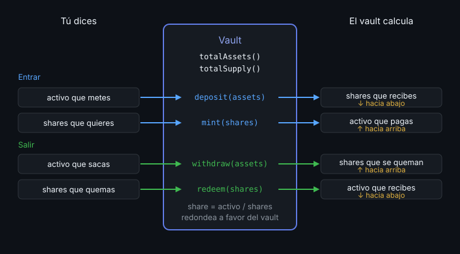

# Teoría 03 — Vaults ERC-4626

## 🎯 Objetivos

- Explicar qué es un **vault** y qué estandariza **ERC-4626**.
- Distinguir las cuatro formas de entrar y salir (`deposit`, `mint`, `withdraw`, `redeem`) y las
  funciones que las anuncian (`preview*`, `max*`, `convertTo*`).
- Saber hacia dónde redondea cada una y por qué.
- Escribir un vault con el `ERC4626` de OpenZeppelin y elegir su offset contra la inflación.
- Reconocer los riesgos de un vault: el regalo, el precio de una share como oráculo y la falta
  de mínimo.

## Qué problema resuelve

Un **vault** (bóveda) es un contrato que guarda un token, el **activo** (*asset*), en nombre de
muchos, y a cambio les da **shares**: un ERC-20 que representa su parte. Si el vault gana algo
(intereses de un préstamo, comisiones de un AMM, el bonus de tu protocolo en el proyecto), el
activo crece y cada share vale más. Quien retira, se lleva su parte de todo.

El vault de la semana 22 hacía esto con su propia interfaz. Antes de ERC-4626, cada
protocolo tenía la suya: una página, un agregador u otro contrato tenían que aprender cada una.
**ERC-4626** (*Tokenized Vault Standard*) fija la interfaz: si un contrato sabe usar un vault
ERC-4626, sabe usarlos todos. Las shares son un ERC-20 normal: se transfieren, se muestran en una
wallet y otro contrato las puede aceptar.

## Cómo funciona

### El precio de una share

Todo sale de dos números: `totalAssets()`, el activo que gestiona el vault, y `totalSupply()`,
las shares que existen. Cuánto vale una share es su cociente:

```text
shares = assets · totalSupply / totalAssets
assets = shares · totalAssets / totalSupply
```

Son `convertToShares` y `convertToAssets`. Son la cuenta "ideal": sin comisiones ni límites.

### Cuatro formas de entrar y salir

| Función | Tú dices | El vault calcula | Lo anuncia antes |
| ------- | -------- | ---------------- | ---------------- |
| `deposit(assets, receiver)` | Cuánto activo metes | Cuántas shares recibes | `previewDeposit` |
| `mint(shares, receiver)` | Cuántas shares quieres | Cuánto activo cuesta | `previewMint` |
| `withdraw(assets, receiver, owner)` | Cuánto activo sacas | Cuántas shares se queman | `previewWithdraw` |
| `redeem(shares, receiver, owner)` | Cuántas shares quemas | Cuánto activo recibes | `previewRedeem` |

Cada `preview*` tiene que dar **exactamente** lo que haría la llamada en ese mismo bloque, con
comisiones incluidas: una página lo llama para enseñar el resultado, y otro contrato, para decidir.
Y cada `max*` (`maxDeposit`, `maxMint`, `maxWithdraw`, `maxRedeem`) dice el mayor importe que la
llamada aceptaría ahora: un vault con tope, en pausa o con un plazo lo anuncia ahí.

Las llamadas emiten `Deposit(sender, owner, assets, shares)` y
`Withdraw(sender, receiver, owner, assets, shares)`.

### Hacia dónde redondea cada una

Las divisiones redondean. El estándar dice hacia dónde: **siempre a favor del vault**, es decir,
de quienes ya están dentro.



| Función | Calcula | Redondea | Por qué |
| ------- | ------- | -------- | ------- |
| `deposit`, `previewDeposit` | shares que recibes | hacia abajo | recibes de menos, nunca de más |
| `mint`, `previewMint` | activo que pagas | hacia arriba | pagas de más, nunca de menos |
| `withdraw`, `previewWithdraw` | shares que se queman | hacia arriba | quemas de más |
| `redeem`, `previewRedeem` | activo que recibes | hacia abajo | recibes de menos |

Si una sola redondeara al revés, un bucle de `deposit` y `redeem` sacaría 1 wei por vuelta del
bolsillo de los demás (semana 22).

### El regalo y las shares virtuales

`totalAssets()` es, en el vault más simple, el saldo del contrato: `balanceOf(address(this))`.
Cualquiera puede subirlo con un `transfer` directo. Es el **ataque de inflación** de la semana 22:
el atacante deposita 1 wei, regala mucho activo y hace que la víctima reciba casi ninguna share.

El `ERC4626` de OpenZeppelin se defiende con **shares virtuales**: cuenta como si siempre hubiera
`10 ^ offset` shares y 1 de activo más de los que hay.

```text
shares = assets · (totalSupply + 10^offset) / (totalAssets + 1)
```

El **offset** lo eliges sobrescribiendo `_decimalsOffset()`, y las shares tienen los decimales del
activo más el offset. Para robar `X` con un regalo, el atacante tendría que regalar del orden de
`10^offset · X`, y lo que regala se lo quedan las shares virtuales.

## Cómo se escribe

**Dónde**: en `src/OffsetVault.sol` de un proyecto Foundry con OpenZeppelin. El vault entero
son estas líneas: OpenZeppelin pone las cuentas, el redondeo y los eventos.

```solidity
// SPDX-License-Identifier: MIT
pragma solidity 0.8.38;

import {ERC20} from "@openzeppelin/contracts/token/ERC20/ERC20.sol";
import {IERC20} from "@openzeppelin/contracts/token/ERC20/IERC20.sol";
import {ERC4626} from "@openzeppelin/contracts/token/ERC20/extensions/ERC4626.sol";

// Un vault ERC-4626 completo: OpenZeppelin pone las cuentas; tú eliges el activo y el offset.
contract OffsetVault is ERC4626 {
    uint8 private immutable OFFSET;

    constructor(IERC20 asset_, uint8 offset) ERC20("Vault", "vTKN") ERC4626(asset_) {
        OFFSET = offset;
    }

    function _decimalsOffset() internal view override returns (uint8) {
        return OFFSET;
    }
}
```

El offset va en el constructor solo para comparar; en un vault de verdad es una constante.

**Dónde**: en `test/Offset.t.sol`, el ataque con cuatro offsets, con el `Token` de prueba de la
semana 22 en `src/Token.sol`:

```solidity
// SPDX-License-Identifier: MIT
pragma solidity 0.8.38;

import {Test, console} from "forge-std/Test.sol";
import {OffsetVault} from "../src/OffsetVault.sol";
import {Token} from "../src/Token.sol";

contract OffsetTest is Test {
    address attacker = makeAddr("attacker");
    address victim = makeAddr("victim");

    // El ataque de la semana 22: 1 wei de depósito, un regalo de 100 y el depósito de la víctima.
    function _attack(uint8 offset) internal returns (uint256 victimGets, uint256 attackerGets) {
        Token token = new Token("Token", "TKN");
        OffsetVault vault = new OffsetVault(token, offset);
        token.mint(attacker, 101 ether);
        token.mint(victim, 100 ether);
        vm.startPrank(attacker);
        token.approve(address(vault), 1);
        vault.deposit(1, attacker);
        token.transfer(address(vault), 100 ether);
        vm.stopPrank();
        vm.startPrank(victim);
        token.approve(address(vault), 100 ether);
        uint256 shares = vault.deposit(100 ether, victim);
        vm.stopPrank();
        victimGets = vault.previewRedeem(shares);
        attackerGets = vault.previewRedeem(vault.balanceOf(attacker));
    }

    function test_Offsets() public {
        uint8[4] memory offsets = [0, 3, 6, 9];
        for (uint256 i = 0; i < offsets.length; i++) {
            (uint256 v, uint256 a) = _attack(offsets[i]);
            console.log(offsets[i], v, a);
        }
    }
}
```

**Ejecuta**: `forge test --mt test_Offsets -vv`

**Salida**:

```text
[PASS] test_Offsets() (gas: 13295368)
  0 66666666666666666667 66666666666666666667
  3 99974993748437109278 50012503125781445361
  6 99999974999993749999 50000012500003125001
  9 99999999974999999994 50000000012500000003
```

| Offset | La víctima deposita 100 y puede sacar | El atacante puso 100 y puede sacar |
| ------ | ------------------------------------- | ---------------------------------- |
| 0 | 66,67 | 66,67 |
| 3 | 99,975 | 50,01 |
| 6 | 99,99997 | 50,00001 |
| 9 | 99,99999997 | 50,00000001 |

Incluso con offset 0, OpenZeppelin cuenta 1 share virtual: el atacante pierde, pero la víctima
pierde un tercio. Con 3 o más, la víctima casi no pierde y el atacante regala la mitad de lo que
puso. Cada punto de offset más es un decimal más en las shares, sin otro coste.

## Antipatrones y riesgos

- **Vault sin shares virtuales.** Un vault escrito a mano, con `totalSupply == 0 ? assets : ...`
  sin offset, es el de la semana 22: el primer depósito se puede robar. Con OpenZeppelin, elige un
  offset de 3 a 6, o haz tú el primer depósito al desplegar.
- **`preview*` que no dice la verdad.** Si añades una comisión y cambias `deposit` pero no
  `previewDeposit`, la página enseña una cifra y la llamada da otra, y un contrato que decide con
  `preview*` se equivoca. Con OpenZeppelin, las llamadas usan las `preview*`: se cambian ellas y
  la llamada las sigue.
- **`max*` que promete de más.** Un vault con tope que no cambia `maxDeposit` dice que acepta
  cualquier importe, y una integración que deposita `maxDeposit` revierte. El ejercicio 02 lo
  corrige.
- **Depositar sin mínimo.** `deposit` no tiene un parámetro de mínimo de shares: entre que firmas
  y que se ejecuta, un regalo o una pérdida del vault cambia el precio de la share. Un contrato que
  deposita compara lo que recibe con `previewDeposit` y revierte si es menos (la extensión
  ERC-5143 añade ese parámetro).
- **El precio de la share como oráculo.** `convertToAssets(1e18)` lo sube cualquiera con un regalo,
  en la misma transacción. Un protocolo de préstamos que acepta shares de un vault como garantía y
  las valora así es el ataque de la semana 22 otra vez.
- **Contar activos que no están.** Si `totalAssets` suma lo que el vault ha prestado o invertido
  en otro sitio, y ese otro sitio pierde, el vault sigue diciendo que vale lo mismo. El primero en
  retirar cobra entero; el último, nada.

## Trucos

- `asset()` devuelve la dirección del activo y `decimals()`, los de las shares: con
  `cast call <vault> "decimals()(uint8)"` sabes el offset que eligió un vault ajeno.
- Para comprobar un vault, prueba lo que promete el estándar: `preview*` igual a la llamada,
  `max*` aceptado por la llamada, y que un `deposit` seguido de `redeem` nunca da más de lo que
  entró. Son los tests de comportamiento del ejercicio 02.
- OpenZeppelin trae un ejemplo de vault con comisiones de entrada y de salida
  (`mocks/docs/ERC4626Fees.sol` en la carpeta de OpenZeppelin de la imagen): el ejercicio 02 hace
  la de salida a mano.

## ✅ Checklist

- [ ] Sé qué es un vault y qué fija ERC-4626.
- [ ] Sé qué dice el usuario y qué calcula el vault en `deposit`, `mint`, `withdraw` y `redeem`.
- [ ] Sé qué prometen `preview*` y `max*`.
- [ ] Sé hacia dónde redondea cada función y por qué.
- [ ] Sé qué hace `_decimalsOffset` y elegir un offset.
- [ ] Sé por qué el precio de una share no sirve como oráculo.

---

| Anterior | Actual | Siguiente |
| -------- | ------ | --------- |
| [← Teoría 02 — La liquidez de un AMM](02-la-liquidez-de-un-amm.md) | **Teoría 03 — Vaults ERC-4626** | [Teoría 04 — Préstamos con garantía →](04-prestamos-con-garantia.md) |
