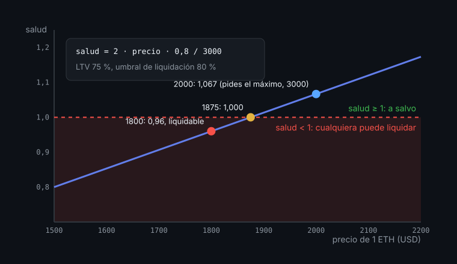

# Teoría 04 — Préstamos con garantía

## 🎯 Objetivos

- Explicar cómo presta un protocolo sin saber quién es nadie: con **garantía** de más.
- Calcular lo máximo que se puede pedir con el **LTV**, y la salud de una posición con el
  **umbral de liquidación**.
- Explicar qué es una **liquidación**, quién la hace y por qué cobra un premio.
- Llevar el interés de todas las deudas con un **índice**, sin recorrer las cuentas.
- Reconocer los riesgos: el oráculo, la deuda incobrable y el redondeo.

## Qué problema resuelve

Un banco presta porque sabe quién eres y puede reclamarte. Un contrato no sabe nada de nadie: una
dirección es una clave, y quien no devuelve desaparece. La solución de DeFi es el **préstamo con
sobregarantía** (*overcollateralized*): para pedir 3000 dólares, depositas una **garantía**
(*collateral*) que vale más, por ejemplo 4000 dólares en ETH. Si no devuelves, el protocolo se
queda con la garantía. Si la garantía baja de precio y deja de cubrir la deuda con margen,
cualquiera puede pagar parte de tu deuda y llevarse tu garantía con descuento.

¿Para qué pedir 3000 si ya tienes 4000? Para no vender: quien cree que su ETH va a subir lo usa
de garantía y gasta los dólares, o los usa en otro protocolo. Es el modelo de Aave y de Compound.

## Cómo funciona

### Lo que vale la garantía

El protocolo necesita un precio de la garantía en la moneda de la deuda: lo lee de un **price
feed** de Chainlink, con las comprobaciones de la semana 20 (precio positivo y reciente), y lo
lleva a 18 decimales. `garantía · precio` es su valor. Nunca del precio de un AMM (teoría 01).

### El LTV y el umbral

Hay dos porcentajes distintos:

- El **LTV** (*loan-to-value*) es lo máximo que puedes pedir frente a lo que vale tu garantía: con
  un 75 %, 4000 dólares de garantía permiten deber 3000.
- El **umbral de liquidación** (*liquidation threshold*) es el punto a partir del cual te pueden
  liquidar: con un 80 %, cuando tu deuda pasa del 80 % del valor de la garantía.

El hueco entre los dos es el margen: puedes pedir el máximo y no te liquidan hasta que la garantía
baje un poco.

### El factor de salud

El **factor de salud** (*health factor*) resume la posición en un número:

```text
salud = valor de la garantía · umbral / deuda
```

Por encima de 1 la posición está a salvo; por debajo, se puede liquidar. Sin deuda, la salud es
infinita.



### La liquidación

Cuando la salud baja de 1, cualquiera puede ser **liquidador**: paga parte de la deuda de otro y
recibe garantía por ese valor, más un **premio** (*liquidation bonus*), un 5 % por ejemplo. El
premio es lo que hace que alguien quiera hacerlo: bots que vigilan todas las posiciones y pagan
el gas de la liquidación para ganarlo.

En cada liquidación se paga como mucho una parte de la deuda, el **close factor** (un 50 %): así
la posición sale de la zona de liquidación sin perder toda la garantía de golpe.

### El interés con un índice

La deuda crece con el tiempo. Recalcular la deuda de cada cuenta cada segundo es imposible: no hay
bucle que recorra miles de cuentas en una transacción. Los protocolos usan un **índice**: un
número que empieza en 1 y crece con el interés de todos a la vez.

- Al pedir `d`, se guarda `d / índice`: la **deuda escalada**.
- La deuda de hoy es `deuda escalada · índice de hoy`.
- Cada función que cambia una deuda actualiza el índice primero: `índice += índice · tipo · tiempo`.

Una sola escritura mueve la deuda de todos. Es el mismo truco de las shares de un vault
(teoría 03): la deuda escalada son "shares de deuda".

## Cómo se escribe

**Dónde**: en `src/Health.sol` de un proyecto Foundry:

```solidity
// SPDX-License-Identifier: MIT
pragma solidity 0.8.38;

library Health {
    uint256 internal constant LTV_BPS = 7500;
    uint256 internal constant LIQUIDATION_THRESHOLD_BPS = 8000;

    // Lo máximo que se puede deber con una garantía que vale `collateralUsd`.
    function maxDebt(uint256 collateralUsd) internal pure returns (uint256) {
        return collateralUsd * LTV_BPS / 10_000;
    }

    // Garantía por el umbral, entre la deuda, con 18 decimales: por debajo de 1e18 se liquida.
    function healthFactor(uint256 collateralUsd, uint256 debtUsd) internal pure returns (uint256) {
        return collateralUsd * LIQUIDATION_THRESHOLD_BPS / 10_000 * 1e18 / debtUsd;
    }
}
```

**Dónde**: en `test/Health.t.sol`:

```solidity
// SPDX-License-Identifier: MIT
pragma solidity 0.8.38;

import {Test, console} from "forge-std/Test.sol";
import {Health} from "../src/Health.sol";

contract HealthTest is Test {
    function test_HealthFactorByPrice() public pure {
        // 2 de garantía y 3000 USD de deuda, el máximo con el precio a 2000.
        uint256 debt = Health.maxDebt(2 * 2000 ether);
        console.log("deuda maxima", debt);
        uint256[4] memory prices = [uint256(2000 ether), 1900 ether, 1875 ether, 1800 ether];
        for (uint256 i = 0; i < prices.length; i++) {
            console.log(prices[i], Health.healthFactor(2 * prices[i], debt));
        }
    }
}
```

**Ejecuta**: `forge test --mt test_HealthFactorByPrice -vv`

**Salida**:

```text
[PASS] test_HealthFactorByPrice() (gas: 22013)
  deuda maxima 3000000000000000000000
  2000000000000000000000 1066666666666666666
  1900000000000000000000 1013333333333333333
  1875000000000000000000 1000000000000000000
  1800000000000000000000 960000000000000000
```

Con 2 ETH a 2000 dólares y 3000 de deuda, la salud es 1,067. Si el ETH baja a 1875, un 6,25 %,
llega a 1: a partir de ahí, cualquiera puede liquidar. A 1800, la salud es 0,96.

Una liquidación a 1800 que paga la mitad de la deuda, 1500, se lleva `1500 · 1,05 / 1800 = 0,875`
ETH: 1575 dólares de garantía por 1500 de deuda, 75 de premio. La posición queda con 1,125 ETH y
1500 de deuda: salud `1,125 · 1800 · 0,8 / 1500 = 1,08`, a salvo otra vez. Son los números del
ejercicio 03.

## Antipatrones y riesgos

- **Un oráculo manipulable.** Todo el protocolo descansa en el precio. Si se lee de un AMM, un
  flash loan lo mueve: el atacante pide prestado contra una garantía inflada, o liquida
  posiciones sanas (semana 22). Feed de Chainlink, con sus comprobaciones.
- **Un precio antiguo.** Si el feed deja de actualizarse y el precio de verdad cae, el protocolo
  sigue prestando con el viejo. `price()` revierte con un precio de más de una hora (semana 20):
  ni se presta ni se liquida hasta que vuelva.
- **Deuda incobrable** (*bad debt*). Si el precio cae tan rápido que la garantía ya vale menos que
  la deuda antes de que nadie liquide, liquidar deja de compensar y la diferencia la pierden los
  que pusieron la liquidez. El hueco entre LTV y umbral, y el premio, existen para que se liquide
  pronto. Una garantía muy volátil necesita un LTV más bajo.
- **Liquidar sin límite.** Sin close factor, un liquidador se lleva toda la garantía con premio en
  cuanto la salud baja de 1, aunque bastaba con pagar una parte. Con él, quien pide prestado pierde
  solo lo necesario.
- **Redondear a favor de quien debe.** La deuda se redondea hacia arriba (`Math.Rounding.Ceil`) y
  lo que se devuelve, hacia abajo: si no, pedir y devolver 1 wei muchas veces dejaría deudas a cero
  que no se pagaron.
- **Olvidar actualizar el índice.** Si `borrow` o `repay` no actualizan el índice antes de cambiar
  la deuda, el interés del periodo se calcula con la deuda nueva: quien pide justo antes paga el
  interés de un tiempo en el que no debía.

## Trucos

- El precio al que te liquidan sale despejando la salud: `precio = deuda / (garantía · umbral)`.
  Con 3000 de deuda y 2 ETH, `3000 / (2 · 0,8) = 1875`.
- Una página enseña la salud con un `cast call <pool> "healthFactor(address)(uint256)" <cuenta>`
  y avisa cuando baja de 1,2: devolver un poco o añadir garantía es más barato que ser liquidado.
- El interés del índice es simple dentro de cada periodo y compuesto entre periodos: cada
  actualización lo capitaliza. Con muchas actualizaciones, un 5 % anual da algo más de un 5 %; con
  una sola en todo el año, como en el test del ejercicio 03, da el 5 % menos el redondeo del tipo
  por segundo: 1000 de deuda pasan a 1049,999999994064.

## ✅ Checklist

- [ ] Sé por qué un préstamo en DeFi pide más garantía que deuda.
- [ ] Sé la diferencia entre LTV y umbral de liquidación.
- [ ] Sé calcular el factor de salud y el precio al que una posición se liquida.
- [ ] Sé qué gana un liquidador y para qué sirve el close factor.
- [ ] Sé llevar el interés de todos con un índice y una deuda escalada.
- [ ] Sé por qué el precio de la garantía sale de un feed, con sus comprobaciones.

---

| Anterior | Actual | Siguiente |
| -------- | ------ | --------- |
| [← Teoría 03 — Vaults ERC-4626](03-vaults-erc-4626.md) | **Teoría 04 — Préstamos con garantía** | [Ejercicio 01 — Un AMM →](../2-practicas/ejercicio-01-un-amm/README.md) |
