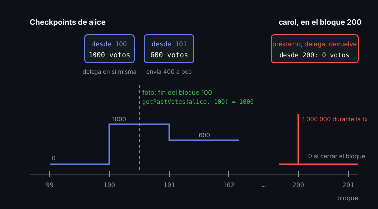

# Teoría 01 — Votos con ERC20Votes

## 🎯 Objetivos

- Explicar qué es una **DAO** y por qué sus votos no pueden ser el saldo del momento.
- Entender la **delegación** y los **checkpoints** de `ERC20Votes`.
- Leer los votos de un bloque pasado con `getPastVotes` y el total con `getPastTotalSupply`.
- Saber qué reloj usa un token de votos (ERC-6372) y qué cuesta en gas.
- Reconocer los errores típicos: tokens sin delegar, votos leídos en el bloque actual y relojes
  mezclados.

## Qué problema resuelve

Tu protocolo tiene, desde la semana 13, una cuenta con `DEFAULT_ADMIN_ROLE` que puede cambiarlo
todo, incluso el código. En la semana 26 lo escribiste como hallazgo: **riesgo de
centralización**. Si alguien roba esa clave, o la persona que la tiene decide mal, nadie más
puede pararla.

Una **DAO** (*Decentralized Autonomous Organization*, organización autónoma descentralizada) es la
alternativa: las decisiones se toman con una votación en un contrato, y el contrato ejecuta lo
que se aprueba. Nadie tiene la clave; tienen votos. Para eso hacen falta tres piezas, una por
teoría: quién vota y cuánto (esta), cómo se propone y se cuenta (teoría 02) y cuánto se espera
antes de ejecutar (teoría 03).

La forma más común de repartir votos es un token: **un token, un voto**. La idea obvia es contar
`balanceOf(votante)` cuando vota. Ya viste en la
[semana 22](../../week-22-vulnerabilidades_economicas/1-teoria/02-flash-loans.md) por qué no
funciona: en abril de 2022, un atacante pidió prestados con un flash loan los tokens de gobernanza
de Beanstalk, votó con ellos su propia propuesta y los devolvió, todo en una transacción. Con
saldos del momento, quien tenga más capital prestado durante un bloque decide.

La respuesta de `ERC20Votes` es preguntar otra cosa: "¿cuántos votos tenías **al acabar el bloque
N**?", con N un bloque ya cerrado. Lo que pase después, incluido un préstamo en el bloque actual,
no cambia esa respuesta.

## Cómo funciona

### Delegar: tener tokens no es votar

En `ERC20Votes`, los votos no son de quien tiene los tokens sino de su **delegado**
(*delegatee*): la cuenta que tú eliges con `delegate(cuenta)`. Puedes delegar en ti mismo o en
otra persona que vote por ti (alguien que sigue las propuestas de cerca). Hasta que delegas, tus
tokens no votan: **el delegado por defecto es nadie**.

Delegar es una decisión sobre todo tu saldo: el de ahora y el que te llegue. No se delega una
parte. Y tu delegado no puede mover tus tokens: solo vota con su peso.

### Checkpoints: una foto por bloque

Guardar los votos de cada cuenta en cada bloque sería imposible. `ERC20Votes` solo guarda los
cambios: por cada delegado, una lista de **checkpoints** (puntos de control), cada uno con un
bloque y los votos que tenía desde ese bloque. Si los votos cambian dos veces en el mismo bloque,
se sobrescribe el último checkpoint: hay uno por bloque como mucho.

Para saber los votos de una cuenta en el bloque N, se busca el último checkpoint con bloque menor
o igual a N. La lista está ordenada por bloque, así que la búsqueda es **binaria**: con mil
checkpoints, unas diez lecturas de `storage`. El ejercicio 01 la escribe a mano.



Cada transferencia mueve votos: del delegado de quien envía al delegado de quien recibe. Cada
mint y cada burn escribe además un checkpoint del **total**, la base del quórum (teoría 02).

### Por qué el bloque tiene que estar cerrado

`getPastVotes(cuenta, N)` revierte si N es el bloque actual o uno futuro. Los votos del bloque
actual todavía pueden cambiar en él: un préstamo que empieza y acaba en el bloque deja su huella
mientras dura. Un bloque cerrado ya no cambia. Por eso un Governor fija la **foto** (*snapshot*)
de cada propuesta en un bloque y solo deja votar después de él.

### El reloj: ERC-6372

"Bloque" es lo que usa `ERC20Votes` por defecto, pero no es la única opción. **ERC-6372** fija
dos funciones para que un token diga qué reloj usa: `clock()` (el instante actual) y
`CLOCK_MODE()` (un texto que lo describe). El Governor lee el reloj del token y mide sus plazos
en esas unidades. Con el reloj por defecto, `CLOCK_MODE()` es `mode=blocknumber&from=default` y
los plazos van en bloques. Un token puede sobrescribir las dos funciones para usar
`block.timestamp`: es lo habitual en L2 (semana 33), donde los bloques no llegan a un ritmo fijo.

## Cómo se escribe

**Dónde**: en `src/GovToken.sol` de un proyecto Foundry con OpenZeppelin. Es el token de los
ejercicios 02 y 03:

```solidity
// SPDX-License-Identifier: MIT
pragma solidity 0.8.38;

import {ERC20} from "@openzeppelin/contracts/token/ERC20/ERC20.sol";
import {ERC20Votes} from "@openzeppelin/contracts/token/ERC20/extensions/ERC20Votes.sol";
import {EIP712} from "@openzeppelin/contracts/utils/cryptography/EIP712.sol";

contract GovToken is ERC20, ERC20Votes {
    constructor() ERC20("Gov Token", "GOV") EIP712("Gov Token", "1") {
        _mint(msg.sender, 1_000_000 ether);
    }

    function _update(address from, address to, uint256 value) internal override(ERC20, ERC20Votes) {
        super._update(from, to, value);
    }
}
```

Dos detalles. `EIP712` es obligatorio: `ERC20Votes` permite delegar con una firma
(`delegateBySig`, con el mismo esquema que el `permit` de la semana 14). Y `_update` existe en
`ERC20` y en `ERC20Votes`: Solidity exige decir cuál gana, y `super` llama a las dos en orden.

**Dónde**: en `test/Votes.t.sol`. `alice` recibe 1000 tokens en el bloque 100, delega en sí misma y
en el bloque 101 envía 400 a `bob`:

```solidity
// SPDX-License-Identifier: MIT
pragma solidity 0.8.38;

import {Test, console} from "forge-std/Test.sol";
import {GovToken} from "../src/GovToken.sol";

contract VotesTest is Test {
    GovToken token;
    address alice = makeAddr("alice");
    address bob = makeAddr("bob");

    function setUp() public {
        vm.roll(100);
        token = new GovToken();
        token.transfer(alice, 1000 ether);
    }

    function test_Delegation() public {
        console.log("saldo  ", token.balanceOf(alice) / 1 ether);
        console.log("votos  ", token.getVotes(alice) / 1 ether);
        vm.prank(alice);
        token.delegate(alice);
        console.log("delega ", token.getVotes(alice) / 1 ether);
        vm.roll(101);
        vm.prank(alice);
        token.transfer(bob, 400 ether);
        vm.roll(102);
        console.log("votos ahora      ", token.getVotes(alice) / 1 ether);
        console.log("votos bloque 100 ", token.getPastVotes(alice, 100) / 1 ether);
        console.log("votos de bob     ", token.getVotes(bob) / 1 ether);
        console.log("checkpoints      ", token.numCheckpoints(alice));
        console.log(token.CLOCK_MODE());
    }

    function test_FutureLookup() public view {
        token.getPastVotes(alice, 100);
    }
}
```

**Ejecuta**: `forge test -vv`

```text
[PASS] test_Delegation() (gas: 319713)
Logs:
  saldo   1000
  votos   0
  delega  1000
  votos ahora       600
  votos bloque 100  1000
  votos de bob      0
  checkpoints       2
  mode=blocknumber&from=default
[FAIL: ERC5805FutureLookup(100, 100)] test_FutureLookup() (gas: 8808)
```

Antes de delegar, 1000 tokens y 0 votos. En el bloque 100 tenía 1000 votos, y esa foto no cambia
aunque hoy tenga 600. `bob` recibió 400 tokens, pero no ha delegado: sus votos son 0. Y preguntar
por el bloque actual revierte con `ERC5805FutureLookup(100, 100)` (ERC-5805 es el estándar de la
interfaz de votos: `delegate`, `getVotes`, `getPastVotes`).

### Lo que cuesta

Mover votos es escribir `storage`. **Dónde**: en el mismo test, una transferencia de `alice` a
`bob` antes de delegar y otra con los dos delegados, en un bloque nuevo:

```solidity
function test_GasTransfer() public {
    vm.prank(alice);
    token.transfer(bob, 1 ether);
    vm.prank(alice);
    token.transfer(bob, 1 ether);
    uint256 g0 = vm.lastFrameGas().gasTotalUsed;
    vm.prank(alice);
    token.delegate(alice);
    vm.prank(bob);
    token.delegate(bob);
    vm.roll(101);
    vm.prank(alice);
    token.transfer(bob, 1 ether);
    uint256 g1 = vm.lastFrameGas().gasTotalUsed;
    console.log("sin delegados", g0);
    console.log("con delegados", g1);
}
```

```text
  sin delegados 39904
  con delegados 107943
```

Casi el triple: cada transferencia añade un checkpoint nuevo a los dos delegados (dos `SSTORE` de
cero a algo, semana 29). Quien no delega no paga ese gas, y por eso el delegado por defecto es
nadie.

## Antipatrones y riesgos

- **Contar `balanceOf` o `getVotes` en el momento de votar.** Es el ataque de Beanstalk: un flash
  loan da la mayoría durante una transacción. La teoría 04 lo prueba contra un contrato que lo
  hace. Una gobernanza lee `getPastVotes` en un bloque cerrado, nunca el valor actual.
- **Olvidar delegar.** Los tokens sin delegar no votan y no cuentan para nadie. Una DAO en la que
  la mayoría no ha delegado se decide con muy pocos votos (teoría 04). Las interfaces de las DAO
  piden delegar al recibir los tokens.
- **Mezclar relojes.** Si el token usa bloques y alguien calcula los plazos del Governor en
  segundos, "un día" de votación son 86 400 bloques: casi doce días con bloques de 12 s. El
  Governor toma el reloj del token: escribe sus plazos en las unidades de `CLOCK_MODE()`.
- **Bloques en una L2.** En algunas L2, `block.number` no avanza como en Ethereum (en Arbitrum
  devuelve un número de bloque de L1 aproximado). Allí, un reloj de bloques da plazos difíciles
  de prever: usa `block.timestamp`.
- **Un token con votos añadidos después.** `ERC20Votes` solo tiene checkpoints desde que se
  despliega. Si añades votos a un token ya desplegado con un contrato nuevo, el reparto de votos
  empieza de cero en ese momento.
- **El tope de los votos.** Los checkpoints guardan los votos en un `uint208`: `ERC20Votes` no
  deja emitir más de `2^208 − 1` unidades y revierte con `ERC20ExceededSafeSupply`. No es un
  problema con un suministro normal, pero sí si tu token emite sin tope.

## Trucos

- `delegates(cuenta)` dice en quién delega cada uno; `numCheckpoints` y `checkpoints` dejan ver la
  lista entera. Con `cast call <token> "getPastVotes(address,uint256)(uint256)" <cuenta> <bloque>`
  ves los votos de cualquier cuenta en una propuesta ajena.
- Para dar votos a un token ya desplegado sin cambiarlo, OpenZeppelin trae `ERC20Wrapper`:
  depositas el token y recibes un envoltorio 1:1 que sí tiene `ERC20Votes`. El vault de tu
  proyecto hace lo mismo con sus shares.
- solc 0.8.38 avisa al compilar `ERC20Votes` o un Governor de OpenZeppelin 5.7:

  ```text
  Warning (6335): "at" will be promoted to keyword in the future and will not be allowed as an identifier anymore.
     --> /opt/lib/openzeppelin-contracts/contracts/utils/structs/DoubleEndedQueue.sol:196:5:
  ```

  Es código de OpenZeppelin (`Checkpoints` y `DoubleEndedQueue` tienen funciones `at`), no tuyo.
  Los `foundry.toml` de esta semana lo silencian solo para esa carpeta, con
  `ignored_warnings_from = ["/opt/lib/openzeppelin-contracts/contracts/utils/structs"]`: un
  warning de tu código sigue apareciendo.

## ✅ Checklist

- [ ] Sé qué es una DAO y por qué sus votos no son el saldo del momento.
- [ ] Sé qué hace `delegate` y por qué unos tokens sin delegar no votan.
- [ ] Sé qué guarda un checkpoint y cómo se busca el de un bloque.
- [ ] Sé por qué `getPastVotes` revierte con el bloque actual.
- [ ] Sé qué dicen `clock()` y `CLOCK_MODE()` y en qué unidades van los plazos.
- [ ] Sé por qué una transferencia con delegados cuesta más gas.

---

| Anterior | Actual | Siguiente |
| -------- | ------ | --------- |
| [← Semana 31 — Gobernanza y DAOs](../README.md) | **Teoría 01 — Votos con ERC20Votes** | [Teoría 02 — El Governor →](02-el-governor.md) |
