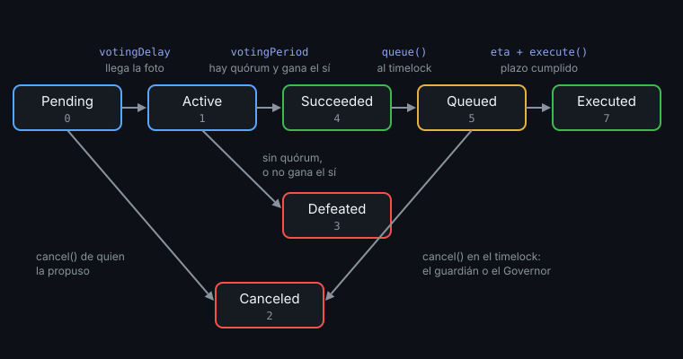

# Teoría 02 — El Governor

## 🎯 Objetivos

- Recorrer el ciclo de una **propuesta**: proponer, esperar la foto, votar, contar y ejecutar.
- Saber qué es el id de una propuesta y por qué depende solo de su contenido.
- Elegir los parámetros de un Governor: retraso, periodo, umbral y quórum.
- Saber qué decide el **módulo de recuento** y montar un Governor con las extensiones de
  OpenZeppelin.
- Reconocer los riesgos: parámetros mal medidos, propuestas que nadie lee y propuestas copiadas.

## Qué problema resuelve

Con `ERC20Votes` (teoría 01) ya sabes cuántos votos tiene cada cuenta en cada bloque. Falta el
contrato que organiza la votación: quién puede proponer, cuándo se vota, qué cuenta como
aprobado y qué pasa después. Es el **Governor**.

Una **propuesta** (*proposal*) no es un texto: es una lista de llamadas. Cada una tiene un
contrato destino (`target`), un valor en wei (`value`) y unos datos (`calldata`, la función y sus
argumentos codificados en ABI, semana 10). Si la propuesta se aprueba, el Governor hace esas
llamadas. "Pagar 1 ETH a dave" es la llamada `Treasury.pay(dave, 1 ether)`. La descripción en
texto la acompaña para las personas, pero el contrato ejecuta la `calldata`, diga lo que diga la
descripción.

El diseño del `Governor` de OpenZeppelin viene de **Governor Bravo**, el de Compound, que fijó las
tres opciones de voto (en contra, a favor y abstención) que usan casi todas las DAO de Ethereum.

## Cómo funciona

### El ciclo de una propuesta



1. **Proponer.** Quien tiene votos suficientes llama a `propose(targets, values, calldatas,
   description)`. El Governor calcula el id, guarda la **foto** (*snapshot*) en `ahora +
   votingDelay` y el final en `foto + votingPeriod`. Estado: `Pending`.
2. **Esperar la foto.** Durante `votingDelay` no se vota. Es tiempo para que quien tiene tokens
   sin delegar delegue, o quien no está de acuerdo, venda. Los votos que cuentan son los del
   bloque de la foto.
3. **Votar.** Desde el bloque siguiente a la foto hasta el final, incluido, el estado es `Active`
   y cada delegado llama a `castVote(id, support)` una vez: 0 en contra, 1 a favor, 2 abstención.
   Vota con `getPastVotes(delegado, foto)`, no con lo que tenga ese día.
4. **Contar.** Al acabar, la propuesta es `Succeeded` si hay **quórum** y gana el sí; si no,
   `Defeated`.
5. **Ejecutar.** Cualquiera llama a `execute` con el mismo contenido. Sin timelock, el Governor
   hace las llamadas y la propuesta queda `Executed`. Con timelock (teoría 03), antes hay que
   ponerla en cola con `queue`: estado `Queued`.

Quien propone puede cancelarla con `cancel` mientras está en `Pending`. El estado `Expired` solo
aparece con timelocks que caducan las operaciones, como el de Compound.

### El id es el contenido

El id de una propuesta es `keccak256(abi.encode(targets, values, calldatas,
keccak256(description)))`: no hay contador. Dos consecuencias. La misma propuesta no se puede
presentar dos veces (revierte con `GovernorUnexpectedProposalState`). Y `queue`, `execute` y
`cancel` no reciben el id, sino el contenido entero otra vez: el Governor recalcula el hash, así
que nadie ejecuta algo distinto de lo que se votó.

### Los parámetros

| Parámetro | Qué es | Unidad |
| --------- | ------ | ------ |
| `votingDelay` | Desde la propuesta hasta la foto | Del reloj del token: bloques o segundos |
| `votingPeriod` | Cuánto dura la votación | Ídem |
| `proposalThreshold` | Votos mínimos (en el bloque anterior) para proponer | Votos |
| `quorum(foto)` | Votos que tienen que participar para que cuente | Votos |

`GovernorVotesQuorumFraction(4)` fija el quórum en el 4 % del total de votos que existía en la
foto (`getPastTotalSupply`, teoría 01). Con un millón de tokens, 40 000.

### El módulo de recuento

El `Governor` base no sabe contar: deja tres funciones `internal` sin escribir, y un módulo de
recuento las escribe.

| Función | Qué decide | En `GovernorCountingSimple` |
| ------- | ---------- | --------------------------- |
| `_countVote` | Qué hace un voto | Suma el peso a su opción. Una vez por cuenta |
| `_quorumReached` | Si participaron bastantes | A favor + abstención ≥ quórum |
| `_voteSucceeded` | Si ganó el sí | A favor > en contra (un empate pierde) |

La abstención cuenta para el quórum pero no para el resultado: sirve para decir "participo y me
da igual". El ejercicio 02 escribe las tres a mano. Otros módulos cuentan distinto:
`GovernorCountingFractional` deja repartir los votos de una cuenta entre las tres opciones.

## Cómo se escribe

Un Governor de OpenZeppelin se monta con extensiones: `GovernorSettings` (los plazos y el
umbral, cambiables por votación), `GovernorCountingSimple` (el recuento), `GovernorVotes` (los
votos de un token `IVotes`), `GovernorVotesQuorumFraction` (el quórum) y
`GovernorTimelockControl` (el timelock de la teoría 03). **Dónde**: en `src/DaoGovernor.sol`; es el
Governor del ejercicio 03:

```solidity
contract DaoGovernor is
    Governor,
    GovernorSettings,
    GovernorCountingSimple,
    GovernorVotes,
    GovernorVotesQuorumFraction,
    GovernorTimelockControl
{
    constructor(IVotes token, TimelockController timelockController)
        Governor("Dao Governor")
        GovernorSettings(7200, 50_400, 10_000 ether)
        GovernorVotes(token)
        GovernorVotesQuorumFraction(4)
        GovernorTimelockControl(timelockController)
    {}

    function votingDelay() public view override(Governor, GovernorSettings) returns (uint256) {
        return super.votingDelay();
    }
    // ... y lo mismo con votingPeriod, proposalThreshold, quorum, state,
    // proposalNeedsQueuing, _queueOperations, _executeOperations, _cancel y _executor.
}
```

7200 bloques de 12 s son un día; 50 400, una semana. El umbral, 10 000 votos, es el 1 % del
suministro. Cada función que existe en dos de los padres se sobrescribe solo para decir que
`super` las llama en orden: no cambian nada. El
[asistente de OpenZeppelin](https://wizard.openzeppelin.com/#governor) las escribe por ti.

**Dónde**: en `test/Lifecycle.t.sol`. `alice` tiene 400 000 de un millón de tokens, delegados, y
propone que la tesorería pague 1 ETH a `dave`. Los números de estado son los de
`IGovernor.ProposalState`: 0 `Pending`, 1 `Active`, 4 `Succeeded`, 5 `Queued` y 7 `Executed`.

```solidity
function test_Lifecycle() public {
    address[] memory targets = new address[](1);
    targets[0] = address(treasury);
    uint256[] memory values = new uint256[](1);
    bytes[] memory calldatas = new bytes[](1);
    calldatas[0] = abi.encodeCall(Treasury.pay, (payable(dave), 1 ether));
    string memory description = "Pagar 1 ETH a dave";
    bytes32 descriptionHash = keccak256(bytes(description));

    vm.prank(alice);
    uint256 id = governor.propose(targets, values, calldatas, description);
    console.log("id", id);
    console.log("snapshot", governor.proposalSnapshot(id), "deadline", governor.proposalDeadline(id));
    console.log("1. estado", uint8(governor.state(id)));
    vm.roll(governor.proposalSnapshot(id) + 1);
    console.log("2. estado", uint8(governor.state(id)));
    vm.prank(alice);
    uint256 weight = governor.castVote(id, 1);
    console.log("   votos", weight / 1 ether, "quorum", governor.quorum(governor.proposalSnapshot(id)) / 1 ether);
    vm.roll(governor.proposalDeadline(id) + 1);
    console.log("3. estado", uint8(governor.state(id)));
    governor.queue(targets, values, calldatas, descriptionHash);
    console.log("4. estado", uint8(governor.state(id)), "eta", governor.proposalEta(id));
    vm.warp(governor.proposalEta(id));
    vm.prank(dave);
    governor.execute(targets, values, calldatas, descriptionHash);
    console.log("5. estado", uint8(governor.state(id)), "dave", dave.balance / 1 ether);
}
```

**Ejecuta**: `forge test -vv --mt test_Lifecycle`

```text
[PASS] test_Lifecycle() (gas: 710771)
Logs:
  id 41532411398946733195011548098350713730010001443798496608465147074558176814104
  snapshot 8201 deadline 58601
  1. estado 0
  2. estado 1
     votos 400000 quorum 40000
  3. estado 4
  4. estado 5 eta 1750172800
  5. estado 7 dave 1
```

La propuesta se hizo en el bloque 1001: foto en el 8201 (+7200) y final en el 58 601 (+50 400).
`alice` sola pasa el quórum de 40 000 y gana. En cola, la `eta` (el momento a partir del cual se
puede ejecutar) es la marca de tiempo de la cola más dos días: el timelock cuenta en segundos,
aunque el Governor cuente en bloques. Y ejecuta `dave`, que no tiene ni un voto: ejecutar lo
aprobado no es un privilegio.

## Antipatrones y riesgos

- **`votingDelay` a cero.** La foto es el bloque de la propuesta: quien tenga tokens sin delegar no
  llega a delegar, y quien propone elige el momento en que la foto le conviene. Un día da tiempo a
  reaccionar.
- **Un periodo corto.** Si una votación dura unas horas, una propuesta presentada un domingo por la
  noche pasa sin que nadie la lea. Una semana es lo habitual.
- **Un quórum mal medido.** Muy bajo, un grupo pequeño decide por todos. Muy alto, nada se aprueba
  y la DAO no puede ni corregir un error. Se mide con la participación real, no con el total.
- **Un umbral en unidades que cambian.** El umbral se cuenta en votos. Si los votos son shares de
  un vault cuyo precio sube (tu proyecto), un número fijo de shares cambia de valor con el tiempo.
- **Fiarse de la descripción.** El contrato ejecuta la `calldata`. Una propuesta que dice "subir
  la comisión" y llama a `transferOwnership` hace lo segundo. Cada propuesta se revisa
  decodificando su `calldata` (`cast calldata-decode`), no leyendo su título.
- **Copiar una propuesta.** Como el id es el contenido, otro puede presentar tu propuesta antes que
  tú (*front-running*, semana 22) y quedar como su autor, con derecho a cancelarla en `Pending`. El
  Governor de OpenZeppelin lo impide si la descripción acaba en `#proposer=0x...` con tu
  dirección: solo esa cuenta puede presentarla.
- **Funciones del Governor que solo cambia el Governor.** `GovernorSettings` deja cambiar los plazos
  con `onlyGovernance`: solo una propuesta aprobada. Si tu Governor añade funciones de
  administración, llévalas detrás del mismo modificador; con `onlyOwner` tendrías otra vez una
  clave con poder.

## Trucos

- `proposalSnapshot`, `proposalDeadline`, `proposalEta`, `proposalProposer` y `state` dicen en qué
  punto está una propuesta. Con `cast call <governor> "state(uint256)(uint8)" <id>` lo ves en
  cualquier red.
- `castVoteWithReason(id, support, "motivo")` deja el motivo en el evento `VoteCast`: es lo que
  enseñan las interfaces de las DAO.
- `hashProposal` da el id antes de proponer: un frontend puede enseñarlo y un script, comprobar que
  coincide con lo que se votó.
- Los tests de un Governor avanzan con `vm.roll` (bloques) y `vm.warp` (segundos, para el
  timelock): necesitas los dos.

## ✅ Checklist

- [ ] Sé qué es una propuesta y por qué se ejecuta la `calldata`, no la descripción.
- [ ] Sé recorrer los estados de una propuesta y qué la mueve de uno a otro.
- [ ] Sé cómo se calcula el id y por qué `execute` recibe el contenido otra vez.
- [ ] Sé qué son `votingDelay`, `votingPeriod`, `proposalThreshold` y el quórum, y en qué unidades
      van.
- [ ] Sé qué decide cada función del módulo de recuento.
- [ ] Sé para qué sirve `#proposer=` al final de una descripción.

---

| Anterior | Actual | Siguiente |
| -------- | ------ | --------- |
| [← Teoría 01 — Votos con ERC20Votes](01-votos-con-erc20votes.md) | **Teoría 02 — El Governor** | [Teoría 03 — El timelock de la DAO →](03-el-timelock-de-la-dao.md) |
