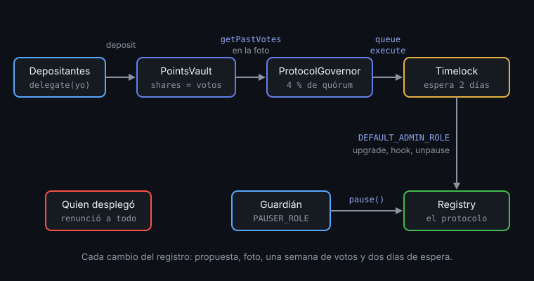

# Teoría 03 — El timelock de la DAO

## 🎯 Objetivos

- Explicar por qué una DAO no ejecuta lo aprobado en el momento.
- Conectar un Governor con un `TimelockController`: quién propone, quién ejecuta, quién cancela y
  quién administra.
- Saber por qué lo que gobierna la DAO tiene que ser del timelock, no del Governor.
- Montar la DAO sin dejar ninguna cuenta con poder: la renuncia del administrador y el guardián.
- Reconocer los riesgos: roles de más, plazos a cero, activos en el contrato equivocado y un
  guardián sin control.

## Qué problema resuelve

En la [semana 13](../../week-13-control_de_acceso/1-teoria/04-timelock-y-multisig.md) pusiste un
contrato bajo un `TimelockController`: cada cambio se programa con `schedule` y no se ejecuta hasta
que pasa el plazo mínimo. Allí programaba una cuenta. Ahora programa el Governor.

Sin timelock, una propuesta aprobada se ejecuta en cuanto acaba la votación. Si es mala (un error
o un ataque que compró votos, teoría 04), los usuarios se enteran cuando ya pasó. Con timelock,
entre la aprobación y la ejecución hay un plazo, por ejemplo dos días. En ese tiempo, quien no
está de acuerdo puede sacar sus fondos del protocolo, y un **guardián** puede cancelar la
operación si es un ataque claro.

## Cómo funciona

### Cuatro roles, cuatro decisiones

`TimelockController` tiene los roles de la semana 13. En una DAO, cada uno tiene un dueño:

| Rol | Qué permite | En la DAO |
| --- | ----------- | --------- |
| `PROPOSER_ROLE` | Programar operaciones | Solo el Governor: lo programado es lo votado |
| `EXECUTOR_ROLE` | Ejecutar lo que ya esperó | `address(0)`: cualquiera |
| `CANCELLER_ROLE` | Cancelar una operación programada | El Governor y, si lo quieres, un guardián |
| `DEFAULT_ADMIN_ROLE` | Dar y quitar los otros roles | Solo el propio timelock |

El último es el que más se olvida. El constructor del timelock se da siempre el rol de
administrador a sí mismo, y además a la cuenta que pases como `admin`. Si esa cuenta no renuncia
después, puede darse `PROPOSER_ROLE` y programar lo que quiera sin votar. Cuando solo el timelock
se administra, cambiar un rol es una operación más: una propuesta, votada y con su plazo.

### Del Governor al timelock



Con `GovernorTimelockControl`, el ciclo de la teoría 02 gana un paso:

1. `queue(contenido)` en el Governor: si la propuesta es `Succeeded`, llama a
   `timelock.scheduleBatch` con todas sus llamadas y el plazo mínimo. Estado: `Queued`.
2. `execute(contenido)` en el Governor: llama a `timelock.executeBatch`. El timelock comprueba que
   el plazo pasó y hace las llamadas **él**. Estado: `Executed`.

Las llamadas salen del timelock, así que `msg.sender` en el contrato gobernado es el timelock. Por
eso lo que gobierna la DAO (los roles del registro, la propiedad de la tesorería, el ETH) tiene
que ser del timelock. Del Governor no: el Governor solo vota.

El id de la operación en el timelock es `hashOperationBatch(targets, values, calldatas, 0, salt)`,
con un **salt** que mezcla la dirección del Governor con el hash de la descripción
(`bytes20(governor) ^ descriptionHash`). Si el guardián cancela esa operación en el timelock, el
Governor lo ve: la propuesta pasa a `Canceled`.

## Cómo se escribe

El Governor necesita la dirección del timelock en su constructor, y el timelock necesita al
Governor como proponente. Una forma de resolverlo: el timelock nace con un administrador
temporal, que da los roles y renuncia en la misma transacción. **Dónde**: en `src/DaoDeployer.sol`,
el contrato que el ejercicio 03 completa paso a paso:

```solidity
constructor(GovToken token, address guardian) {
    address[] memory none = new address[](0);
    address[] memory anyone = new address[](1);
    timelock = new TimelockController(MIN_DELAY, none, anyone, address(this));
    governor = new DaoGovernor(token, timelock);
    treasury = new Treasury(address(this));

    timelock.grantRole(timelock.PROPOSER_ROLE(), address(governor));
    timelock.grantRole(timelock.CANCELLER_ROLE(), address(governor));
    timelock.grantRole(timelock.CANCELLER_ROLE(), guardian);
    treasury.transferOwnership(address(timelock));
    timelock.renounceRole(timelock.DEFAULT_ADMIN_ROLE(), address(this));
}
```

`anyone` es un array con un elemento, `address(0)`: el valor por defecto. `MIN_DELAY` es
`2 days`. Al acabar el constructor, `DaoDeployer` ya no puede nada. El script de tu proyecto hace
lo mismo de otra forma: calcula la dirección del Governor antes de desplegarlo
(`vm.computeCreateAddress`, semana 30) y crea el timelock sin administrador.

Lo que pasa si la tesorería se queda en el Governor: **dónde**, en `test/Lifecycle.t.sol`, la
propuesta del ejemplo de la teoría 02 con una tesorería cuyo dueño es el Governor. Votación,
cola y plazo van bien; la ejecución, no:

```solidity
function test_TreasuryOwnedByTheGovernor() public {
    Treasury wrong = new Treasury(address(governor));
    vm.deal(address(wrong), 10 ether);
    // ... propose, castVote, queue y warp hasta la eta, como en test_Lifecycle
    console.log("timelock", address(timelock));
    governor.execute(targets, values, calldatas, h);
}
```

**Ejecuta**: `forge test -vv --mt test_TreasuryOwnedByTheGovernor`

```text
[FAIL: OwnableUnauthorizedAccount(0x2e234DAe75C793f67A35089C9d99245E1C58470b)] test_TreasuryOwnedByTheGovernor() (gas: 961714)
  timelock 0x2e234DAe75C793f67A35089C9d99245E1C58470b
```

Quien llama a `pay` es el timelock, y la tesorería no es suya. La propuesta aprobada no se puede
ejecutar nunca: hay que votar otra.

### El guardián

Un plazo sin nadie que pueda reaccionar solo sirve para irse. El **guardián** es una cuenta (en
producción, un multisig de la semana 13) con un poder pequeño y rápido: cancelar una operación en
cola, o pausar. No puede proponer ni ejecutar nada. Cuánto poder tiene es una decisión de la DAO,
y la DAO se lo puede quitar con una propuesta (`revokeRole`), como hace el último test del
ejercicio 03.

En tu proyecto, el guardián solo tiene `PAUSER_ROLE` en el registro: puede parar las altas sin
esperar dos días, pero reanudarlas (`unpause`) es del administrador, que ahora es la DAO.

### Un cambio, día a día

Con los números del ejemplo de la teoría 02 (bloques de 12 s, un día de retraso, una semana de
votación y dos días de timelock), esto es lo que tarda un cambio y lo que puede hacer cada uno:

| Momento | Estado | Lo que puede hacer quien no está de acuerdo |
| ------- | ------ | ------------------------------------------- |
| Día 0, bloque 1001 | `Pending` | Leer la `calldata`, avisar, delegar antes de la foto |
| Día 1, bloque 8201 | Foto | Ya no cambia sus votos en esta propuesta |
| Días 1 a 8 | `Active` | Votar en contra o abstenerse |
| Día 8, bloque 58 601 | `Succeeded` o `Defeated` | Si se aprobó, prepararse para salir |
| Día 8, `queue` | `Queued` | Retirar sus fondos; el guardián, cancelar o pausar |
| Día 10, `eta` | Ejecutable | Nada: cualquiera llama a `execute` |

Diez días desde la propuesta hasta el efecto. Es lento a propósito: una DAO no es para
emergencias. Lo urgente (parar las altas si aparece un bug) lo hace el guardián en una
transacción; lo que cambia el protocolo pasa por los diez días.

### Cambiar las reglas de la DAO

Los plazos y los roles también se cambian votando. Las funciones que lo hacen solo aceptan
llamadas de quien ejecuta las propuestas:

| Qué | Función | Quién la acepta |
| --- | ------- | --------------- |
| El plazo del timelock | `timelock.updateDelay` | Solo el propio timelock |
| Los roles del timelock | `timelock.grantRole`, `revokeRole` | Su administrador: el propio timelock |
| Los plazos y el umbral del Governor | `setVotingDelay`, `setVotingPeriod`, `setProposalThreshold` | `onlyGovernance`: una propuesta ejecutada |
| El quórum | `updateQuorumNumerator` | `onlyGovernance` |

Una propuesta que quita el rol al guardián tiene como `target` el propio timelock y como
`calldata` `revokeRole(CANCELLER_ROLE, guardian)`: el timelock se llama a sí mismo al ejecutarla.
Es `test_Paso5_RolesOnlyChangeByProposal` del ejercicio 03. Y una propuesta que acorta el plazo a
cero también es posible: por eso cada propuesta que toca las reglas merece más atención que las
demás.

## Antipatrones y riesgos

- **Otro proponente en el timelock.** Cualquier cuenta con `PROPOSER_ROLE` programa operaciones
  sin votar: el timelock solo comprueba el rol. El único proponente es el Governor.
- **No renunciar al administrador.** Es el caso de arriba: quien despliega se queda con una puerta
  trasera que ningún test de la votación ve. Se comprueba con `hasRole(DEFAULT_ADMIN_ROLE, ...)`.
- **Plazo mínimo a cero.** El timelock ejecuta en el mismo bloque que la cola: es un Governor sin
  timelock con más gas. Cambiar el plazo (`updateDelay`) solo lo puede el propio timelock, es
  decir, una propuesta.
- **Activos en el Governor.** Lo que es del Governor no lo puede mover una propuesta que ejecuta
  el timelock. Y al revés: con `relay`, el Governor puede hacer llamadas en su nombre, pero solo
  desde una propuesta. Manda el ETH y los roles al timelock.
- **Un ejecutor concreto.** Si solo una cuenta puede ejecutar, esa cuenta puede bloquear lo
  aprobado sin hacer nada. `address(0)` deja ejecutar a cualquiera lo que ya esperó.
- **Un guardián con demasiado poder.** Si puede cancelar todo, gobierna en negativo: ninguna
  propuesta que no le guste sale adelante. Si puede pausar y nadie más reanudar, para el protocolo
  hasta que la DAO vote. Su poder tiene que estar escrito y la DAO tiene que poder quitárselo.

## Trucos

- `getMinDelay`, `isOperationPending`, `isOperationReady` e `isOperationDone` del timelock dicen
  dónde está cada operación. El evento `CallScheduled` sale al poner algo en cola: es el que vigila
  quien quiere enterarse a tiempo.
- `proposalEta(id)` en el Governor da el momento exacto a partir del cual se puede ejecutar.
- En los tests, avanza el reloj del timelock con `vm.warp` y el de la votación con `vm.roll`. Si
  ejecutas un segundo antes de la `eta`, el error es
  `TimelockUnexpectedOperationState(id, 0x...04)`: el último número es el estado esperado,
  `Ready`, como un bit (`1 << 2`).

## ✅ Checklist

- [ ] Sé por qué una DAO espera entre aprobar y ejecutar.
- [ ] Sé quién tiene cada rol del timelock en una DAO y por qué.
- [ ] Sé qué hacen `queue` y `execute` con `GovernorTimelockControl`.
- [ ] Sé por qué lo gobernado tiene que ser del timelock.
- [ ] Sé montar la DAO sin que nadie se quede de administrador.
- [ ] Sé qué puede y qué no puede hacer un guardián, y quién se lo quita.

---

| Anterior | Actual | Siguiente |
| -------- | ------ | --------- |
| [← Teoría 02 — El Governor](02-el-governor.md) | **Teoría 03 — El timelock de la DAO** | [Teoría 04 — Ataques a la gobernanza →](04-ataques-a-la-gobernanza.md) |
