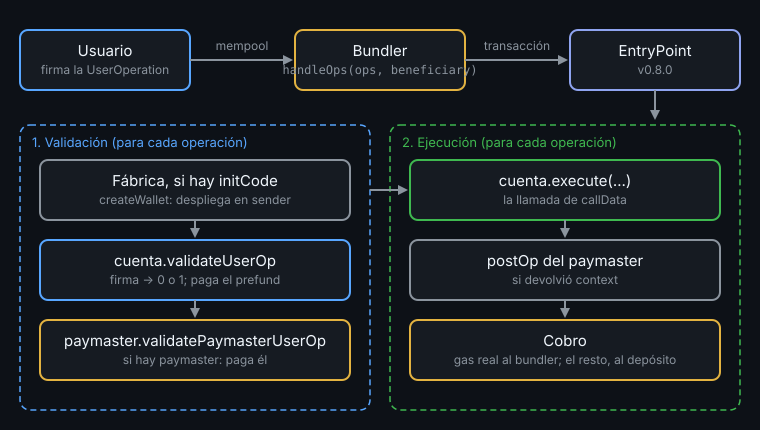

# Teoría 01 — Cuentas y UserOperations

## 🎯 Objetivos

- Explicar qué no puede hacer una EOA y qué cambia cuando la cuenta es un contrato.
- Nombrar las piezas de ERC-4337: la cuenta, la UserOperation, el bundler y el EntryPoint.
- Recorrer lo que hace `handleOps`: validar todas las operaciones y después ejecutarlas.
- Escribir `validateUserOp`: la firma, el prefund y qué devolver cuando la firma no vale.
- Leer los errores `AA` del EntryPoint y saber qué parte de la operación falló.

## Qué problema resuelve

Desde la semana 1 cada transacción la firma una **EOA** (*externally owned account*): una cuenta
que es solo una clave privada. Eso tiene cuatro límites que ya has sufrido:

| Límite | Consecuencia |
| ------ | ------------ |
| Una clave, para siempre | Si la pierdes, pierdes la cuenta; si te la roban, se llevan todo |
| El gas se paga en ETH | Quien tiene puntos del protocolo pero no ETH no puede usarlo |
| Una llamada por transacción | `approve` y luego la llamada: dos transacciones, dos firmas |
| La firma es ECDSA sobre secp256k1 | Nada de passkeys, multisig o reglas propias sin un contrato aparte |

La **abstracción de cuentas** (*account abstraction*) consiste en que la cuenta sea un contrato:
el contrato decide qué firma vale, quién paga el gas y qué se ejecuta. En la semana 13 ya viste
una cuenta así, el multisig, pero para usarlo alguien tenía que mandar una transacción desde una
EOA. **ERC-4337** resuelve eso sin cambiar el protocolo de Ethereum: define un contrato común, el
**EntryPoint**, y una estructura, la **UserOperation**, que sustituye a la transacción.

## Cómo funciona

### Las piezas

| Pieza | Qué es | En esta semana |
| ----- | ------ | -------------- |
| Cuenta (*smart account*) | Un contrato con `validateUserOp`: dice si una operación es suya | `SimpleWallet` del ejercicio 01 |
| UserOperation | Lo que el usuario firma: quién, qué llamada, cuánto gas y a qué precio | `PackedUserOperation` |
| Bundler | Un nodo que junta UserOperations y las envía en una transacción normal | `bundler` en los tests |
| EntryPoint | El contrato único que valida, ejecuta y cobra | `EntryPoint` v0.8.0 de eth-infinitism |
| Paymaster | Un contrato que paga el gas de otros | Teoría 03 |
| Fábrica (*factory*) | Despliega la cuenta en su primera operación | Teoría 02 |

El usuario no envía transacciones: firma UserOperations y las manda a un mempool aparte, el de
los bundlers. Un bundler elige varias, las mete en una llamada a `EntryPoint.handleOps` y paga el
gas de esa transacción con su EOA. El EntryPoint le devuelve lo gastado, cobrándolo a cada cuenta
(o a su paymaster). El bundler gana la diferencia entre lo que cobra y lo que paga.

### La UserOperation

En la v0.8 del EntryPoint se llama `PackedUserOperation`: varios números van juntos en una palabra
de 32 bytes para ahorrar calldata.

| Campo | Qué lleva |
| ----- | --------- |
| `sender` | La cuenta (el contrato) que ejecuta |
| `nonce` | Clave (192 bits) y secuencia (64 bits): el EntryPoint lleva la cuenta |
| `initCode` | Vacío, o fábrica + llamada que despliega la cuenta (teoría 02) |
| `callData` | Lo que el EntryPoint llama en la cuenta: por ejemplo `execute(destino, valor, datos)` |
| `accountGasLimits` | Gas de la validación (128 bits altos) y de la llamada (128 bajos) |
| `preVerificationGas` | Gas que el bundler gasta fuera de las llamadas: calldata, firma de su transacción |
| `gasFees` | Propina máxima (`maxPriorityFeePerGas`) y precio máximo (`maxFeePerGas`), como EIP-1559 |
| `paymasterAndData` | Vacío, o paymaster + sus límites de gas + sus datos (teoría 03) |
| `signature` | Lo que la cuenta comprueba; su formato lo decide la cuenta |

Lo que se firma es el `userOpHash`: un hash EIP-712 (semana 14) de todos los campos menos la
firma, con la dirección del EntryPoint y el `chainid` en el dominio. Una firma no vale en otra
red ni en otro EntryPoint.

### Lo que hace `handleOps`



`handleOps(ops, beneficiary)` tiene dos bucles:

1. **Validación**, para cada operación: si hay `initCode`, despliega la cuenta; calcula el gas
   máximo que puede costar (`requiredPrefund`); llama a `validateUserOp` de la cuenta; comprueba
   que la cuenta pagó lo que faltaba de ese máximo y que el nonce es el siguiente.
2. **Ejecución**, para cada operación: llama a la cuenta con `callData`, mide el gas, calcula lo
   que costó de verdad y devuelve el resto al depósito de la cuenta.

Al final, todo lo cobrado va a `beneficiary`, la cuenta del bundler. Si la validación de una
operación falla, revierte la transacción entera: el bundler debió simularla antes. Si falla la
ejecución, no: la operación se cobra igual y el EntryPoint emite su evento con `success = false`.
Por eso el bundler solo paga gas que le van a devolver.

### `validateUserOp`

La interfaz `IAccount` tiene una sola función:

```solidity
function validateUserOp(PackedUserOperation calldata userOp, bytes32 userOpHash, uint256 missingAccountFunds)
    external
    returns (uint256 validationData);
```

La cuenta hace tres cosas:

- **Comprueba quién llama.** Solo el EntryPoint. Si no, cualquiera la llama con un
  `missingAccountFunds` enorme y se lleva el ETH que la cuenta manda en el tercer punto.
- **Comprueba la firma** sobre `userOpHash` y devuelve `0` si vale y `1` si no. No revierte: una
  firma mala es una respuesta, no un error. Los bits de arriba de `validationData` pueden llevar
  además un plazo (teoría 03).
- **Paga el prefund**: manda al EntryPoint `missingAccountFunds`, lo que le falta a su depósito
  para cubrir el gas máximo. Lo que sobre se queda en el depósito para la siguiente operación.

El nonce no lo comprueba la cuenta: lo lleva el EntryPoint. Cada clave de 192 bits tiene su propia
secuencia, así que una cuenta puede tener varias colas de operaciones que no se bloquean entre sí.

## Cómo se escribe

**Dónde**: en `src/SimpleWallet.sol` del ejercicio 01, la cuenta resuelta:

```solidity
function validateUserOp(PackedUserOperation calldata userOp, bytes32 userOpHash, uint256 missingAccountFunds)
    external
    returns (uint256 validationData)
{
    if (msg.sender != address(entryPoint)) revert NotEntryPoint(msg.sender);
    validationData = _validateSignature(userOp.signature, userOpHash);
    _payPrefund(missingAccountFunds);
}

function _validateSignature(bytes calldata signature, bytes32 userOpHash) internal view returns (uint256) {
    (address signer, ECDSA.RecoverError err,) = ECDSA.tryRecover(userOpHash, signature);
    if (err != ECDSA.RecoverError.NoError || signer != owner) return SIG_VALIDATION_FAILED;
    return SIG_VALIDATION_SUCCESS;
}
```

`tryRecover` en lugar de `recover`: con una firma ilegible, `recover` revierte, y la cuenta debe
devolver `1`. En el test, el dueño firma el hash que da el propio EntryPoint y el bundler la envía:

```solidity
op.accountGasLimits = bytes32((uint256(150_000) << 128) | 100_000);
op.preVerificationGas = 50_000;
op.gasFees = bytes32((uint256(1 gwei) << 128) | 1 gwei);
(uint8 v, bytes32 r, bytes32 s) = vm.sign(ownerKey, entryPoint.getUserOpHash(op));
op.signature = abi.encodePacked(r, s, v);
vm.prank(bundler, bundler);
entryPoint.handleOps(ops, payable(bundler));
```

**Ejecuta**: `forge test -vv --mt test_Lifecycle`, con un test que imprime lo que pasó:

```text
[PASS] test_Lifecycle() (gas: 963571)
Logs:
  userOpHash
  0xb31ae496a1bca144bdea055902badd1b8f9d7ebe619a2483d180f26637e53b4f
  count 1
  pagado al bundler 157177000000000
  saldo de la cuenta 999700000000000000
  deposito en el EntryPoint 142823000000000
  nonce 1
  nonce clave 7 129127208515966861312
```

La cuenta tenía 1 ETH y mandó 0,0003 ETH: los 300 000 de gas máximo (150 000 + 100 000 + 50 000)
a 1 gwei. La operación costó 157 177 gwei, que fueron al bundler; los 142 823 gwei que sobran se
quedan en el EntryPoint a nombre de la cuenta. El nonce de la clave 0 pasó a 1. El de la clave 7
empieza en `7 << 64`: la clave va en los bits altos y la secuencia, a 0, en los bajos.

### Los errores `AA`

Cuando la validación falla, el EntryPoint revierte con `FailedOp(índice, motivo)` o
`FailedOpWithRevert(índice, motivo, error interno)`. El código dice qué parte falló: `AA1x`, la
fábrica; `AA2x`, la cuenta; `AA3x`, el paymaster. Los del ejercicio 01, copiados de su salida:

| Error | Cuándo sale en el ejercicio 01 |
| ----- | ------------------------------ |
| `FailedOpWithRevert(0, "AA23 reverted", ...)` | `validateUserOp` revierte: el `revert("TODO: Paso 1")` va dentro, en ABI |
| `FailedOp(0, "AA21 didn't pay prefund")` | La cuenta valida pero no manda el ETH |
| `FailedOp(0, "AA24 signature error")` | La cuenta devuelve `1`: la firma no es del dueño |
| `FailedOp(0, "AA25 invalid account nonce")` | La misma operación, enviada otra vez |
| `FailedOp(0, "AA13 initCode failed or OOG")` | La fábrica revierte o se queda sin gas al desplegar |

## Antipatrones y riesgos

- **`validateUserOp` sin comprobar quién llama.** Es el paso 3 del ejercicio 01: cualquiera la
  llama con `missingAccountFunds` igual al saldo y la cuenta se lo manda. Solo el EntryPoint.
- **`execute` abierto.** Si cualquiera puede llamar a `execute`, la firma no protege nada. Solo el
  EntryPoint (que ya validó) o el dueño.
- **Revertir con una firma mala.** El EntryPoint lo trata como un fallo de la cuenta (`AA23`) y no
  como una firma mala; los bundlers que simulan con firmas falsas para estimar gas fallan.
- **Firmar algo que no es el `userOpHash`.** Si la cuenta firma solo `callData`, la misma firma
  sirve en otra red, con otro nonce o con otro precio de gas.
- **Límites de gas a ojo.** El EntryPoint v0.8 cobra un 10 % del gas de ejecución reservado y no
  usado, si sobran más de 40 000: un `callGasLimit` diez veces mayor de lo necesario se paga.
- **Confiar en el EntryPoint equivocado.** La cuenta guarda la dirección del EntryPoint en su
  código. Un EntryPoint falso puede llamar a `execute` con lo que quiera.

## Trucos

- `entryPoint.getUserOpHash(op)` calcula el hash que hay que firmar; en los tests, guárdalo en una
  variable antes de `vm.prank` o `vm.expectRevert`: es una llamada externa y se los come.
- `entryPoint.balanceOf(cuenta)` da el depósito; `depositTo` lo recarga y `withdrawTo` lo saca.
- `vm.prank(bundler, bundler)` fija `msg.sender` y `tx.origin`: así se ve un bundler de verdad.
- Lee el evento `UserOperationEvent` con `-vvvv`: trae `success`, `actualGasCost` y
  `actualGasUsed` de cada operación.

## ✅ Checklist

- [ ] Sé qué cuatro cosas no puede hacer una EOA y cuáles resuelve una cuenta contrato.
- [ ] Sé qué hacen el bundler, el EntryPoint y la cuenta en ERC-4337.
- [ ] Sé qué campos tiene una `PackedUserOperation` y qué se firma.
- [ ] Sé qué hace cada bucle de `handleOps` y qué pasa si falla la validación o la ejecución.
- [ ] Sé escribir `validateUserOp`: quién llama, la firma sin revertir y el prefund.
- [ ] Sé leer un error `AA` y saber qué parte de la operación falló.

---

| Anterior | Actual | Siguiente |
| -------- | ------ | --------- |
| [← Semana 32 — Account abstraction](../README.md) | **Teoría 01 — Cuentas y UserOperations** | [Teoría 02 — Cuentas, fábricas y firmas →](02-cuentas-fabricas-y-firmas.md) |
