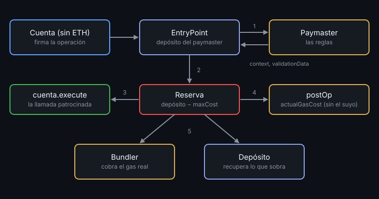

# Teoría 03 — Paymasters

## 🎯 Objetivos

- Explicar qué hace un paymaster y de dónde sale el ETH con el que paga.
- Escribir `validatePaymasterUserOp`: qué decide, qué devuelve y cuándo revertir.
- Usar `postOp` y su `context`, y saber qué coste ve y cuál no.
- Codificar un plazo en `validationData` y entender por qué no se comprueba con `block.timestamp`.
- Reconocer cómo se vacía el depósito de un paymaster y qué reglas lo impiden.

## Qué problema resuelve

En la teoría 01 la cuenta paga su gas con su propio ETH. Pero el usuario de tu protocolo tiene
puntos, no ETH, y no sabe qué es el gas. Un **paymaster** es un contrato que paga el gas de las
operaciones de otros: un protocolo que patrocina a sus usuarios, una app que cobra en otro token,
una empresa que regala las primeras operaciones. La cuenta firma la operación; el paymaster dice
si la paga.

Pagar por otros es dar dinero a quien lo pida. Todo lo que hace un paymaster es decidir, en la
validación, a quién y por qué sí.

## Cómo funciona

### El depósito y el stake

El paymaster no paga con su saldo: paga con un **depósito** en el EntryPoint (`deposit()` o
`entryPoint.depositTo(paymaster)`). En cada operación que acepta, el EntryPoint descuenta del
depósito el gas máximo y, al final, le devuelve lo que no se usó. Si el depósito no llega, la
operación ni se valida: `AA31 paymaster deposit too low`.

El **stake** es otra cosa: ETH bloqueado con un plazo de retirada (`addStake(unstakeDelaySec)`).
No paga nada. Es la fianza que los bundlers piden a un paymaster que usa su propio storage en la
validación (ERC-7562, teoría 02): si el paymaster hace fallar muchas operaciones, los bundlers lo
limitan, y el stake hace que no pueda cambiar de dirección gratis.

### `paymasterAndData`

La operación elige su paymaster en `paymasterAndData`:

| Bytes | Qué |
| ----- | --- |
| 0-19 | Dirección del paymaster |
| 20-35 | `paymasterVerificationGasLimit`: gas de su validación |
| 36-51 | `paymasterPostOpGasLimit`: gas de su `postOp` |
| 52-... | Datos para el paymaster: por ejemplo una firma de quien patrocina |

Con paymaster, el gas máximo (`maxCost`) suma también esos dos límites. En el test del ejercicio
02, `paymasterAndData = abi.encodePacked(address(paymaster), uint128(100_000), uint128(50_000))`.

### Las dos llamadas



1. **`validatePaymasterUserOp(userOp, userOpHash, maxCost)`**, en el bucle de validación, después
   de la cuenta. Devuelve `context` (bytes para después) y `validationData` (plazos, o `1` si
   una firma del paymaster no vale). Revertir es decir que no: `AA33 reverted`.
2. **`postOp(mode, context, actualGasCost, actualUserOpFeePerGas)`**, después de ejecutar, solo si
   `context` no está vacío. `mode` dice si la llamada de la cuenta fue bien o revirtió.

Las dos solo las puede llamar el EntryPoint. `BasePaymaster` de eth-infinitism lo comprueba y
deja dos funciones internas para escribir: `_validatePaymasterUserOp` y `_postOp`.

### El plazo, en `validationData`

`validationData` es un `uint256` con tres partes:

| Bits | Qué |
| ---- | --- |
| 0-159 | `0` válido, `1` firma mala (o la dirección de un agregador) |
| 160-207 | `validUntil`: hasta cuándo vale; `0` es para siempre |
| 208-255 | `validAfter`: desde cuándo vale |

El paymaster no puede comparar con `block.timestamp`: `TIMESTAMP` está prohibido en la validación
(ERC-7562). Devuelve el plazo y lo comprueba el EntryPoint. Si pasó: `AA32 paymaster expired or
not due` (o `AA22` si el plazo lo puso la cuenta). `_packValidationData(false, validUntil, 0)` de
`Helpers.sol` lo empaqueta.

## Cómo se escribe

**Dónde**: en `src/SponsorPaymaster.sol` del ejercicio 02, resuelto. Patrocina las llamadas a un
contrato, con un tope por operación, un presupuesto por cuenta y una fecha de fin:

```solidity
function _validatePaymasterUserOp(PackedUserOperation calldata userOp, bytes32, uint256 maxCost)
    internal
    view
    override
    returns (bytes memory context, uint256 validationData)
{
    _checkCall(userOp.callData);
    if (maxCost > MAX_COST) revert TooExpensive(maxCost);
    uint256 spent = spentBy[userOp.sender];
    if (spent + maxCost > budget) revert OverBudget(userOp.sender, spent, maxCost);
    context = abi.encode(userOp.sender);
    validationData = _packValidationData(false, validUntil, 0);
}

function _postOp(PostOpMode, bytes calldata context, uint256 actualGasCost, uint256) internal override {
    address account = abi.decode(context, (address));
    spentBy[account] += actualGasCost;
}
```

`_checkCall` decodifica `callData`: tiene que ser `SimpleWallet.execute(target, 0, ...)`. El
presupuesto se comprueba con `maxCost`, lo peor que puede costar, porque en la validación todavía
no se sabe lo que costará.

**Ejecuta**: `forge test -vv --mt test_Sponsored`, con un test que imprime el `validationData` y
lo que pasó con el gas. La cuenta no tiene ni un wei:

```text
[PASS] test_Sponsored() (gas: 9543278)
Logs:
  validationData
  0x0000000000000000773594000000000000000000000000000000000000000000
  saldo de la cuenta 0
  baja del deposito 169601000000000
  pagado al bundler 169601000000000
  visto en postOp 145903000000000
```

`0x77359400` es 2 000 000 000, el `validUntil`, a partir del bit 160. Lo que bajó el depósito es
exactamente lo que cobró el bundler. Y `postOp` vio menos: `actualGasCost` es el coste hasta antes
de `postOp`. El gas del propio `postOp` y la penalización por gas no usado se cobran después. Un
presupuesto que solo suma `actualGasCost` se queda corto, a favor del usuario.

Cuando una regla dice que no, el error de la regla va dentro del `AA33`:

```text
[FAIL: FailedOpWithRevert(0, "AA33 reverted", 0x08c379a00000000000000000000000000000000000000000000000000000000000000020000000000000000000000000000000000000000000000000000000000000000c544f444f3a205061736f20310000000000000000000000000000000000000000)] test_Paso1_TheWalletPaysNothing() (gas: 133038)
```

En el starter del ejercicio 02 ese error interno es `Error("TODO: Paso 1")` codificado en ABI; con
el paso resuelto, el selector de `NotSponsored()`.

### Los errores `AA3x`

Los del paymaster empiezan por `AA3`. Los de esta semana, tal como los escribe el EntryPoint v0.8.0:

| Error | Qué pasó |
| ----- | -------- |
| `AA31 paymaster deposit too low` | El depósito no cubre `maxCost`: nadie hizo `deposit()`, o se gastó |
| `AA32 paymaster expired or not due` | El `validationData` del paymaster tiene un plazo y ya pasó (o no ha llegado) |
| `AA33 reverted` | `validatePaymasterUserOp` revirtió: una regla dijo que no; el error interno va detrás |
| `AA34 signature error` | El paymaster devolvió `1` en los bits bajos: una firma suya no vale |
| `AA36 over paymasterVerificationGasLimit` | La validación del paymaster gastó más de lo que permite `paymasterAndData` |

El starter del proyecto da `AA31` en todos sus tests: el script todavía no deposita.

### Tipos de paymaster

| Tipo | Cómo decide | Riesgo propio |
| ---- | ----------- | ------------- |
| De reglas (el de esta semana) | Lo que se llama, cuánto cuesta, cuántas veces | Las reglas son todo lo que protege el depósito |
| De firma (*verifying*) | Un servidor firma cada operación que patrocina; la firma va en `paymasterAndData` | Si se filtra la clave del servidor, se vacía el depósito |
| De token (ERC-20) | Cobra a la cuenta en un token, en `postOp`, con un precio de un oráculo | El precio (semana 20) y que la cuenta no tenga el token al final |

## Antipatrones y riesgos

- **Patrocinar cualquier llamada.** Un paymaster que solo mira el destino paga también lo que el
  destino haga con otros datos; uno que solo mira el selector paga la misma función en un contrato
  del atacante. Mira las dos cosas, y el valor.
- **Sin tope por operación.** Quien envía la operación elige los límites de gas. Con
  `callGasLimit` de diez millones, una sola operación cuesta lo que cien.
- **Sin cupo por cuenta.** Si cada operación es razonable, mil lo son menos. Y crear cuentas es
  gratis: el cupo por cuenta solo sirve si cada cuenta cuesta algo (tener puntos, por ejemplo).
- **Contar en `postOp` lo que debía frenar la validación.** Si la llamada revierte, `postOp` se
  llama igual (con `mode` de revert), pero si `postOp` revierte, el EntryPoint deshace la llamada
  y cobra el gas al paymaster. Lo que decide si se paga va en la validación.
- **Leer estado ajeno en la validación.** Un precio de un oráculo, el `paused()` de otro contrato:
  los bundlers lo rechazan (ERC-7562). Copia a `immutable` lo que no cambia.
- **El depósito en manos de una clave.** `withdrawTo` es del dueño del paymaster. En tu proyecto,
  del timelock de la DAO.

## Trucos

- `entryPoint.balanceOf(paymaster)` es el depósito; `getDepositInfo(paymaster)` trae además el
  stake y su plazo.
- Para probar una regla, envía una operación que solo rompa esa regla: si rompe dos, el test pasa
  aunque falte una.
- En un test, firma antes de `vm.expectRevert`: `getUserOpHash` es una llamada externa.
- Si `context` está vacío, el EntryPoint no llama a `postOp` y puedes poner su límite de gas a 0.
- Calcula `maxCost` en el test con la misma suma que el EntryPoint (los cinco límites de gas por
  `maxFeePerGas`) para esperar el error exacto de `TooExpensive(maxCost)`.
- `withdrawTo` saca del depósito; `unlockStake` y, tras el plazo, `withdrawStake` sacan el stake.

## ✅ Checklist

- [ ] Sé de dónde sale el ETH con el que paga un paymaster y para qué sirve el stake.
- [ ] Sé qué lleva `paymasterAndData`.
- [ ] Sé qué decide `validatePaymasterUserOp` y qué devuelve.
- [ ] Sé qué coste ve `postOp` y cuál se cobra después.
- [ ] Sé poner un plazo en `validationData` y por qué no se usa `block.timestamp`.
- [ ] Sé qué reglas protegen el depósito y cómo probar cada una por separado.

---

| Anterior | Actual | Siguiente |
| -------- | ------ | --------- |
| [← Teoría 02 — Cuentas, fábricas y firmas](02-cuentas-fabricas-y-firmas.md) | **Teoría 03 — Paymasters** | [Teoría 04 — EIP-7702 →](04-eip-7702.md) |
