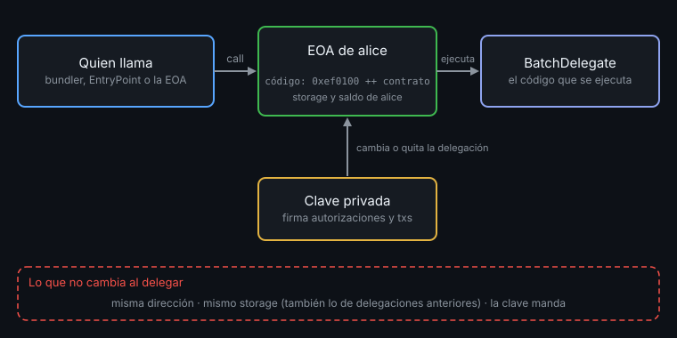

# Teoría 04 — EIP-7702

## 🎯 Objetivos

- Explicar qué hace una transacción de EIP-7702 y qué queda en la EOA después.
- Firmar y adjuntar una autorización en Foundry, y leer el código que deja.
- Escribir código para una EOA: quién puede llamarlo y dónde guarda su estado.
- Combinar EIP-7702 con ERC-4337: la EOA como cuenta del EntryPoint.
- Reconocer los riesgos: storage de delegaciones anteriores, inicialización, `tx.origin` y la
  autorización como phishing.

## Qué problema resuelve

Las cuentas de las teorías 01 a 03 son contratos nuevos, con dirección nueva. El usuario que ya
tiene una EOA con sus tokens, su historial y su nombre tendría que mudarse. **EIP-7702**, que entró
en mainnet con la actualización Pectra el 7 de mayo de 2025, deja que una EOA tenga código sin
cambiar de dirección: la EOA **delega** en un contrato, y desde ese momento quien llama a la EOA
ejecuta el código de ese contrato, con el storage y el saldo de la EOA.

La EOA no deja de ser EOA: su clave privada sigue firmando transacciones normales y puede cambiar
o quitar la delegación cuando quiera. Gana lo que tiene una cuenta contrato (lotes, patrocinio,
otras firmas) y conserva lo que tenía.

## Cómo funciona

### La autorización

Una transacción de tipo `0x04` (*set code transaction*) lleva, además de lo normal, una lista de
**autorizaciones**. Cada una es una tupla firmada por la EOA que delega (la *authority*):

| Campo | Qué es |
| ----- | ------ |
| `chain_id` | La red; `0` vale en todas |
| `address` | El contrato en el que delega |
| `nonce` | El nonce de la EOA: la autorización solo vale una vez |
| `y_parity`, `r`, `s` | La firma de la EOA |

La transacción la puede enviar cualquiera, y paga quien la envía. Antes de ejecutarla, la red
procesa cada autorización: comprueba la firma y el nonce, sube el nonce de la EOA y le escribe un
código de 23 bytes, el **designador**:

```text
0xef0100 ++ dirección del contrato
```

`0xef` es un byte que ningún contrato puede tener al principio de su código (EIP-3541), así que el
designador no se confunde con código normal. Cuando alguien llama a la EOA, la EVM ve el
designador y ejecuta el código del contrato en el contexto de la EOA: `address(this)` es la EOA,
el storage es el de la EOA, y `msg.value` llega a la EOA. Es un `DELEGATECALL` (semana 10) que no
se pide en cada llamada: queda escrito en la cuenta.

Delegar en `address(0)` borra el designador: la EOA vuelve a no tener código. El storage que
escribió el contrato, en cambio, se queda.

### En Foundry

`vm.signAndAttachDelegation(contrato, clave)` firma la autorización con la clave de la EOA y la
adjunta a la siguiente llamada del test, como si viajara en su transacción. **Dónde**: en
`test/Lifecycle.t.sol`, un test que delega a alice en `BatchDelegate` (el del ejercicio 03):

```solidity
BatchDelegate impl = new BatchDelegate();
console.log("implementacion", address(impl));
vm.signAndAttachDelegation(address(impl), aliceKey);
(bool ok,) = alice.call("");
require(ok);
console.logBytes(alice.code);
```

**Ejecuta**: `forge test -vv --mt test_Delegation`

```text
  implementacion 0x5991A2dF15A8F6A256D3Ec51E99254Cd3fb576A9
  codigo de alice
  0xef01005991a2df15a8f6a256d3ec51e99254cd3fb576a9
```

Los 23 bytes: `ef0100` y los 20 de la dirección del contrato.

### En anvil, con `cast`

anvil 1.9 arranca con Prague, la parte de Pectra que trae EIP-7702. `cast send --auth` firma la
autorización con la clave de quien envía y la mete en una transacción de tipo 4. **Dónde**: en el
contenedor, con anvil en marcha y `BatchDelegate` desplegado por la cuenta 0 de anvil en
`0x5FbDB2315678afecb367f032d93F642f64180aa3`. alice es la cuenta 1 de anvil:

```bash
echo y | cast send $ALICE --auth $IMPL --private-key $ALICE_KEY
cast code $ALICE
cast nonce $ALICE
```

```text
Warning: This command will send a signed EIP-7702 authorization to the RPC endpoint. The authorization can be submitted on-chain by anyone once its nonce is valid.
status               1 (success)
type                 4
0xef01005fbdb2315678afecb367f032d93f642f64180aa3
2
```

`cast` pide confirmación (el `echo y` la da) y avisa de lo importante: la autorización firmada la
puede enviar cualquiera mientras su nonce valga. El nonce de alice pasó de 0 a 2: uno por la
transacción y otro por la autorización. Delegar en `address(0)` con otra transacción igual deja
`cast code $ALICE` en `0x` y el nonce en 4.



### Código para una EOA

El contrato en el que se delega no tiene constructor que valga (el constructor se ejecutó al
desplegarlo, en su dirección, no en la EOA) y su storage es el de cada EOA que delega. Eso cambia
tres cosas respecto a un contrato normal:

**Quién manda.** No hay `owner`: el dueño es la clave de la EOA. Una llamada que la EOA se hace a
sí misma, en una transacción suya, llega con `msg.sender == address(this)`. **Dónde**: en
`src/BatchDelegate.sol` del ejercicio 03:

```solidity
function execute(Call[] calldata calls) external payable {
    if (msg.sender != address(this)) revert Unauthorized(msg.sender);
    _executeBatch(calls);
}
```

Para que otro envíe y pague, la EOA firma lo que quiere hacer, y el contrato comprueba que la
firma es de `address(this)`, con el `chainid`, la dirección, un nonce y un plazo dentro del hash.
Es `executeWithSignature` del ejercicio 03: lo mismo que `registerBySig` de la semana 14.

**Dónde guarda.** Si la EOA delegó antes en otro contrato que escribió en el slot 0, ese valor
sigue ahí. Un contrato para EOAs guarda su estado en un slot propio, con ERC-7201 (semana 15):

```solidity
/// @custom:storage-location erc7201:bootcamp.BatchDelegate
struct DelegateStorage {
    uint256 nonce;
}

bytes32 private constant STORAGE_SLOT = 0xb65fc48599bdae15717ba796c47e752ea9327f57b6be417b75729fa3a8ce2900;
```

El slot es `keccak256(abi.encode(uint256(keccak256("bootcamp.BatchDelegate")) - 1)) & ~bytes32(uint256(0xff))`,
calculado con `cast keccak` en el contenedor. El último test del ejercicio 03 delega primero en un
contrato que guarda 42 en el slot 0 y luego en `BatchDelegate`: el 42 sigue ahí, y el nonce, en su
slot, empieza en 0.

**Cómo se inicializa.** No se inicializa: no hay constructor. Si el contrato necesita configurarse
(un dueño adicional, un límite), la configuración la tiene que firmar la EOA. Un `initialize()`
abierto lo llama primero quien vea la delegación en el mempool.

### EIP-7702 con ERC-4337

Una EOA delegada en una cuenta de ERC-4337 es una cuenta más para el EntryPoint: tiene código, así
que no necesita `initCode`. El EntryPoint v0.8.0 fue el primero que lo admite. `SignerEIP7702` de
OpenZeppelin comprueba la firma contra `address(this)`: la clave de la EOA firma las
UserOperations. Es lo que hace tu proyecto: alice, con puntos y sin ETH, firma la autorización y la
operación; el bundler las envía juntas y el paymaster paga.

## Antipatrones y riesgos

- **Firmar una autorización sin leerla.** Delegar es dar a un contrato todo lo que tiene la EOA.
  Una web maliciosa que pide una autorización pide la cuenta entera. Y con `chain_id = 0`, en
  todas las redes a la vez.
- **Storage en el slot 0.** Un contrato para EOAs con variables normales choca con lo que dejó la
  delegación anterior. Usa ERC-7201.
- **`initialize` sin firma.** Cualquiera lo llama antes que la EOA. La configuración, firmada por
  la EOA o ninguna.
- **`tx.origin == msg.sender` para saber que no es un contrato.** Ya no lo garantiza: una EOA
  delegada que se llama a sí misma ejecuta código. Los contratos que lo usaban como defensa contra
  reentrancia o contra bots la pierden.
- **`extcodesize == 0` para saber que es una EOA.** Una EOA delegada tiene 23 bytes de código.
- **Creer que la clave ya no importa.** La clave privada sigue mandando: puede firmar otra
  delegación o mandar una transacción normal. EIP-7702 no añade recuperación si la clave se
  pierde; la añade el contrato, si la tiene.
- **Firmas sin `chainid` ni `address(this)`.** La misma firma valdría en otra red y en otra EOA
  que delegue en el mismo contrato.

## Trucos

- `vm.signDelegation` firma sin adjuntar y `vm.attachDelegation` adjunta una ya firmada: útil para
  probar que otro envía la autorización.
- `cast code <eoa>` en una red con Pectra muestra el designador: comprueba en qué delegó una
  cuenta antes de mandarle nada.
- En los tests, `vm.load(eoa, slot)` lee el storage de la EOA: así ves qué dejó cada delegación.
- `vm.chainId(10)` cambia la red del test: la forma rápida de probar que una firma no vale en otra.
- Antes de delegar en un contrato, lee su código entero: no tiene constructor que lo proteja, y
  todo lo que pueda hacer lo podrá hacer con tu cuenta.

## ✅ Checklist

- [ ] Sé qué lleva una autorización de EIP-7702 y quién paga la transacción.
- [ ] Sé qué código queda en la EOA y qué pasa al llamarla.
- [ ] Sé escribir un contrato para EOAs: `msg.sender == address(this)` y firmas de la EOA.
- [ ] Sé por qué el storage va en un slot de ERC-7201.
- [ ] Sé por qué un contrato para EOAs no se inicializa con una llamada abierta.
- [ ] Sé qué suposiciones rompe EIP-7702 (`tx.origin`, `extcodesize`).

---

| Anterior | Actual | Siguiente |
| -------- | ------ | --------- |
| [← Teoría 03 — Paymasters](03-paymasters.md) | **Teoría 04 — EIP-7702** | [Ejercicio 01 — Una cuenta para el EntryPoint →](../2-practicas/ejercicio-01-una-cuenta-para-el-entrypoint/README.md) |
