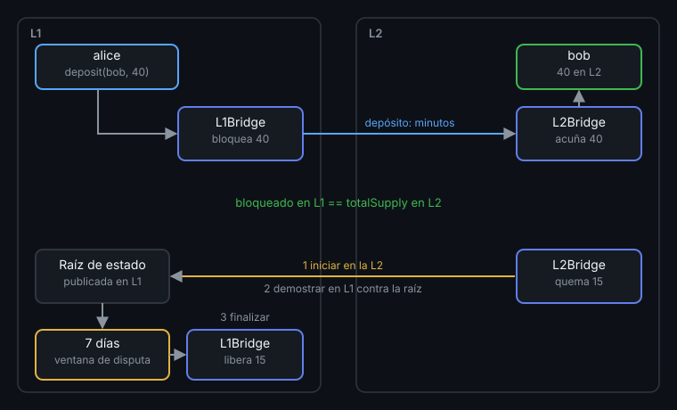

# Teoría 03 — Puentes

## 🎯 Objetivos

- Explicar por qué un token no puede "moverse" de una cadena a otra y qué hace un puente.
- Distinguir los modelos de puente: bloquear y acuñar, quemar y acuñar, y redes de liquidez.
- Seguir un depósito y una retirada por el puente canónico del OP Stack.
- Escribir las dos mitades de un puente de bloquear y acuñar sobre un mensajero.
- Reconocer cómo se han robado miles de millones en puentes y qué invariante los protege.

## Qué problema resuelve

Cada cadena es un libro de cuentas aparte. Tus puntos de L1 son una entrada en el storage del
`LoyaltyToken` de L1, y la L2 no puede leerlo ni cambiarlo. Llevar puntos a la L2 significa dos
cosas a la vez: que en L1 dejen de estar disponibles y que en la L2 aparezcan los mismos.

Un **puente** (bridge) es la pareja de contratos (uno en cada cadena) que hace eso, más un modo de
que cada mitad se entere de lo que pasó en la otra. Ese modo es lo difícil: un contrato solo ve su
propia cadena.

## Cómo funciona

### Tres modelos

| Modelo | Al ir a la otra cadena | Al volver | Ejemplo |
| ------ | ---------------------- | --------- | ------- |
| **Bloquear y acuñar** (lock and mint) | Se bloquea el token en el origen y se acuña una representación en el destino | Se quema la representación y se libera el original | El puente estándar del OP Stack |
| **Quemar y acuñar** (burn and mint) | Se quema en el origen y se acuña en el destino | Lo mismo al revés | Tokens cuyo emisor controla las dos cadenas, como el USDC de Circle (CCTP) |
| **Red de liquidez** | Un intermediario te paga en el destino con sus fondos | Recupera lo tuyo en el origen más tarde | Puentes rápidos como Across |

En bloquear y acuñar, cada unidad de la L2 está **respaldada** por una bloqueada en L1. El
invariante es:

```text
lo bloqueado en el puente de L1 == totalSupply() del token en la L2
```

Si alguien acuña en la L2 sin bloquear en L1, todo lo acuñado vale menos, porque el bote de L1 ya
no alcanza para todos. Lo mismo si alguien saca de L1 sin quemar en la L2.

### Quién dice qué pasó en la otra cadena

Lo que distingue a los puentes de verdad es **de quién te fías** para saber que el depósito
ocurrió:

- **El propio rollup** (puente canónico o nativo). Los mensajes de L1 a L2 los incluye el rollup;
  los de L2 a L1 se demuestran contra la raíz de estado (teoría 01). Te fías de lo mismo que para
  usar la L2.
- **Un comité** de validadores o un multisig externo que firma lo que pasó. Rápido y para
  cualquier par de cadenas, pero si se hacen con las claves, se hacen con el bote.
- **Clientes ligeros o pruebas ZK** que verifican en el destino el consenso del origen. Lo más
  cercano a no fiarse de nadie, y lo más caro.

### El puente estándar del OP Stack



**Depósito**, de L1 a la L2:

1. Llamas a `L1StandardBridge` en L1. Bloquea tu token (o tu ETH) y envía un mensaje por el
   mensajero de L1, que pasa por el `OptimismPortal`.
2. El rollup ve el evento de L1 y crea en la L2 una **transacción de depósito**: el mensajero de
   la L2 (`0x4200000000000000000000000000000000000007`) entrega el mensaje a `L2StandardBridge`
   (`0x4200000000000000000000000000000000000010`).
3. `L2StandardBridge` comprueba que el mensaje viene del puente de L1 y acuña el token de la L2.

Tarda lo que tarda L1 en confirmar y el rollup en verlo: minutos.

**Retirada**, de la L2 a L1, en tres transacciones:

1. **Iniciar**, en la L2: `L2StandardBridge` quema y envía un mensaje al puente de L1.
2. **Demostrar**, en L1: cuando la raíz de estado que incluye tu retirada está publicada, envías
   la prueba de que tu mensaje está en esa raíz.
3. **Finalizar**, en L1: pasada la ventana de disputa (7 días), el portal entrega el mensaje y el
   puente de L1 libera el token.

El plazo es el del rollup optimista: hasta que la raíz no puede disputarse, L1 no sabe si la
retirada existió de verdad.

## Cómo se escribe

El ejercicio 03 escribe un puente de bloquear y acuñar sobre el mensajero del ejercicio 02. Las
dos mitades heredan de `BridgeBase`, que guarda el mensajero de su cadena y la dirección de la otra
mitad, y trae la comprobación que lo protege todo:

```solidity
modifier onlyOtherBridge() {
    if (msg.sender != address(messenger) || messenger.xDomainMessageSender() != otherBridge) {
        revert NotOtherBridge();
    }
    _;
}
```

El depósito, en `L1Bridge`: primero bloquea, después pide a la otra mitad que acuñe.

```solidity
function deposit(address to, uint256 amount) external {
    token.safeTransferFrom(msg.sender, address(this), amount);
    messenger.sendMessage(
        otherBridge, abi.encodeCall(L2Bridge.finalizeDeposit, (msg.sender, to, amount)), FINALIZE_GAS
    );
    emit DepositInitiated(msg.sender, to, amount);
}
```

En `L2Bridge`, acuñar solo si el mensaje lo envió el puente de L1:

```solidity
function finalizeDeposit(address from, address to, uint256 amount) external onlyOtherBridge {
    token.mint(to, amount);
    emit DepositFinalized(from, to, amount);
}
```

La retirada es el camino inverso: `L2Bridge.withdraw` quema y envía `finalizeWithdrawal`, y
`L1Bridge.finalizeWithdrawal`, con `onlyOtherBridge`, libera con `safeTransfer`. `BridgedToken`
solo deja acuñar y quemar a `L2Bridge`.

Cada mitad necesita la dirección de la otra en su constructor. En el test se calcula antes de
desplegar con `vm.computeCreateAddress` (semana 10); en dos cadenas de verdad, con CREATE2 desde
la misma fábrica (teoría 02).

## Antipatrones y riesgos

Los puentes son el sitio donde más se ha robado en esta industria. Tres casos de 2022, con sus
análisis en [rekt.news](https://rekt.news/leaderboard/):

- **Claves del comité robadas.** En Ronin bastaban 5 firmas de 9 validadores para aprobar una
  retirada, y cuatro las controlaba la misma organización. El atacante consiguió cinco y sacó más
  de 600 millones de dólares. Un puente de comité vale lo que sus claves.
- **Acuñar sin comprobar bien quién lo pide.** En Wormhole, la verificación de firmas de los
  guardianes en Solana se podía saltar con una cuenta falsa: el atacante acuñó 120 000 wETH sin
  depositar nada. Es `finalizeDeposit` sin `onlyOtherBridge`.
- **Una inicialización que lo acepta todo.** En Nomad, una actualización dejó como raíz de
  confianza el valor cero, y con eso cualquier mensaje no probado pasaba por probado. Cientos de
  cuentas copiaron la transacción del primer atacante cambiando la dirección de destino.

Y los errores de diseño que el código del ejercicio 03 no tiene que cometer:

- **Mirar solo `msg.sender == messenger`.** Cualquiera puede enviar un mensaje por el mensajero:
  hay que mirar también quién lo envió al otro lado (teoría 04).
- **Acuñar lo pedido y no lo recibido.** Un token con comisión por transferencia deja en el puente
  menos de lo que dice `amount`; si la L2 acuña `amount`, el respaldo se rompe. Mide el saldo antes
  y después, o no admitas esos tokens.
- **Un solo puente para cualquier token sin lista.** Si el puente acepta "el token de L1 que me
  digas" y lo empareja con "el token de L2 que me digas", alguien empareja su token sin valor con
  el bueno.
- **Suponer que la retirada siempre se puede terminar.** Si la llamada final revierte para siempre
  (un destinatario que rechaza el token, un puente pausado sin salida), los fondos quedan
  quemados en la L2 y bloqueados en L1.

## Trucos

- Prueba el invariante del respaldo con fuzzing (semana 24): deposita y retira cantidades
  aleatorias y compara lo bloqueado con el `totalSupply()` de la L2, como
  `testFuzz_Paso5_LockedBacksTheL2Supply`.
- En un test, una retirada de un rollup optimista se entrega después de
  `vm.warp(block.timestamp + 7 days)`: no hace falta para que pase, pero recuerda el plazo.
- Para tokens que tienen que existir en muchas cadenas, mira antes si su emisor ya ofrece un
  puente de quemar y acuñar: un token puenteado por terceros no es el mismo token.
- Lee el código del puente que vayas a usar en `docs.optimism.io` y `docs.arbitrum.io`: los
  nombres de esta teoría (`L1StandardBridge`, `OptimismPortal`) son los suyos.

## ✅ Checklist

- [ ] Sé qué hace un puente y por qué necesita contratos en las dos cadenas.
- [ ] Sé distinguir bloquear y acuñar, quemar y acuñar y una red de liquidez.
- [ ] Sé de quién se fía cada tipo de puente.
- [ ] Sé seguir un depósito y una retirada por el puente del OP Stack, y por qué la retirada tarda.
- [ ] Sé escribir las dos mitades de un puente y su invariante de respaldo.
- [ ] Sé qué falló en Ronin, Wormhole y Nomad.

---

| Anterior | Actual | Siguiente |
| -------- | ------ | --------- |
| [← Teoría 02 — Desplegar en una L2](02-desplegar-en-una-l2.md) | **Teoría 03 — Puentes** | [Teoría 04 — Mensajes entre cadenas →](04-mensajes-entre-cadenas.md) |
